---
output:
  xaringan::moon_reader:
    seal: false
    includes:
      after_body: insert-logo.html
    self_contained: false
    lib_dir: libs
    nature:
      highlightStyle: github
      highlightLines: true
      countIncrementalSlides: false
      ratio: '16:9'
editor_options:
  chunk_output_type: console
---
class: center, inverse, middle

```{r xaringan-panelset, echo=FALSE}
xaringanExtra::use_panelset()
```

```{r xaringan-tile-view, echo=FALSE}
xaringanExtra::use_tile_view()
```

```{css echo=FALSE}
.pull-left {
  float: left;
  width: 44%;
}
.pull-right {
  float: right;
  width: 44%;
}
.pull-right ~ p {
  clear: both;
}


.pull-left-wide {
  float: left;
  width: 66%;
}
.pull-right-wide {
  float: right;
  width: 66%;
}
.pull-right-wide ~ p {
  clear: both;
}

.pull-left-narrow {
  float: left;
  width: 30%;
}
.pull-right-narrow {
  float: right;
  width: 30%;
}

.pull-right-extra-narrow {
  float: right;
  width: 20%;
}

.pull-center {
  margin: 0 auto;
  width: 44%;
}
.pull-center-wide {
  margin: 0 auto;
  width: 66%;
}
.pull-center-medium {
  margin: 0 auto;
  width: 60%;
}

.tiny123 {
  font-size: 0.40em;
}

.small123 {
  font-size: 0.80em;
}

.large123 {
  font-size: 2em;
}

.eq150 {
  font-size: 1.25em;
}

.red {
  color: red
}

.orange {
  color: orange
}

.green {
  color: green
}

.blue {
  color: #2c4f8a
}

.chaosred {
  color: #b33d3d
}

/* Painting slide: text box over a full-bleed image */
.overlay-box {
  background: rgba(0, 0, 0, 0.62);
  color: #fff;
  padding: 0.6em 1.1em;
  border-radius: 6px;
  display: inline-block;
}
.overlay-box h1, .overlay-box h2 {
  color: #fff;
  margin: 0.2em 0 0.3em 0;
}
.overlay-spoiler {
  margin-top: 0.8em;
}
.title-sm h1 {
  font-size: 34px;
}
.boe-left {
  float: left;
  clear: left;
  width: 37%;
}
.boe-right {
  float: right;
  width: 60%;
}
.boe-col, .boe-col p, .boe-col li {
  font-size: 20px;
}
.gmap-frame {
  position: absolute;
  top: 0;
  left: 0;
  width: 100%;
  height: 100%;
  border: 0;
}
.regtab table {
  font-size: 17px;
  margin: 0 auto;
}
.regtab td, .regtab th {
  padding: 4px 12px;
  text-align: center;
}
.regtab td:first-child, .regtab th:first-child {
  text-align: left;
}
.bigq {
  font-size: 220px;
  line-height: 1;
  color: #b33d3d;
  text-align: center;
  font-weight: bold;
}
.bigq p {
  margin: 0;
}
.map-inset {
  position: absolute;
  right: 3%;
  bottom: 6%;
  width: 24%;
  background: rgba(255, 255, 255, 0.9);
  border-radius: 6px;
  padding: 0.4em;
}
.map-inset img {
  width: 100%;
  display: block;
}
.map-effect {
  position: absolute;
  left: 2%;
  width: 17%;
  top: 25%;
  text-align: right;
  line-height: 1;
}
.map-effect .num {
  font-size: 3.6em;
  font-weight: bold;
  color: #d9730d;
}
.map-effect .lab {
  font-size: 0.85em;
  color: #333;
}
.remark-slide-content .footnote {
  left: 64px;
  right: 64px;
}
.overlay-narrow {
  max-width: 9em;
  margin-left: -1.5em;
}
.remark-slide-content.bottom .overlay-box {
  margin-bottom: 1.8em;
}
.overlay-credit {
  position: absolute;
  bottom: 12px;
  left: 20px;
  font-size: 0.55em;
  color: #fff;
  background: rgba(0, 0, 0, 0.55);
  padding: 2px 8px;
  border-radius: 4px;
}
```

# A Perfect Storm
## First-Nature Geography and Economic Development

### **Christian Vedel**,
### University of Southern Denmark

### Email: [christian-vs@sam.sdu.dk](mailto:christian-vs@sam.sdu.dk)

### Updated `r Sys.Date()`

.footnote[
.left[
.small123[
*Paper: [arxiv.org/abs/2408.00885](https://arxiv.org/abs/2408.00885). Replication package: [github.com/christianvedels/A_perfect_storm](https://github.com/christianvedels/A_perfect_storm)*
]
]
]

???
(⏱ minutes on this slide / cumulative minutes at the end of it / main-talk slides left; 30-minute plan, Other work slides not counted)
⏱ 0.5 / 0.5 / 31
STRUCTURE (fractal) — each layer retells the whole story in more detail:
- By minute 4: painting + map + live map
- By minute 6.5: who I am, the covid-vacation pictures, the two pillars ("if I were out of time, I would end here")
- By minute 9: the question and the literature
- By minute 18.5: one full pass through the evidence
- By minute 30: mechanisms, the mirror experiment
- By minute 60: ongoing work and agenda
- Up to 120: deep dives after the conclusion
SECRET LINKS: click "SDU" in the logo -> conclusion; click the twig in the logo -> ongoing work and agenda. Same corner works invisibly on dark slides.

---
name: opening
class: left, top
background-image: url(Figures/locher_kuling_KKS1399.jpg)
background-size: cover

.overlay-box[
## Why do some places prosper while others do not?

What is the role of first-nature geography?
]

.overlay-credit[
Carl Locher, *Frisk kuling i Sundet* (1892). SMK, KKS1399, public domain.
]

--

.overlay-box.overlay-spoiler[
**What I do:** in 1825 a storm suddenly changed first-nature geography. I follow the region through **millions of individual census records, 1787–1901**.
]

--

.overlay-box.overlay-spoiler[
**Trade followed. A generation later, population was 27% higher, with more farmers, fishermen and textile workers.**
]

???
⏱ 2 / 2.5 / 30
- WHY (box 1): explaining prosperity is one of the biggest asks in economics. The tension: first nature (geography) and second nature (institutions, what people build) are almost impossible to disentangle, because they arrive together.
- WHAT (box 2): a natural experiment — first nature suddenly changed — observed in millions of individual census records, 1787–1901.
- RESULT (box 3): trade followed; +27% population a generation later, with an occupational shift towards farmers, fishermen and textile workers; the mirror experiment 700 years earlier.

---
name: map
class: center

```{r echo=FALSE, out.width="72%", fig.align='center'}
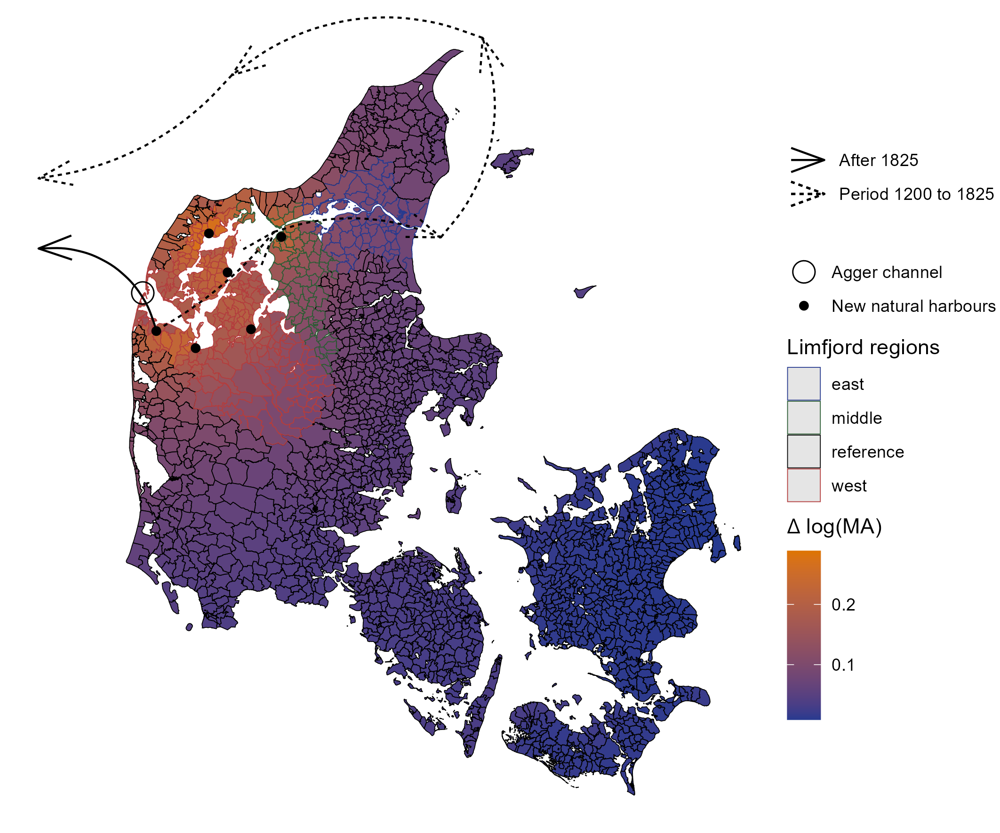
```

--

.map-effect[<span class="num">+27%</span><br><span class="lab">population by 1901</span>]

???
⏱ 0.5 / 3 / 29
- This map is the whole story. Before 1834 a merchant in the west Limfjord sailed east via Aalborg and round the top of Jutland. Then the storm opened the western route.
- "If I were already out of time, I would end here."
- END OF LAYER 1 after the live map (minute 4).

---
name: gmap
class: hide-logo

<iframe class="gmap-frame" src="https://maps.google.com/maps?q=56.700,8.242&t=k&z=11&output=embed" loading="lazy" allowfullscreen referrerpolicy="no-referrer-when-downgrade"></iframe>

???
⏱ 1 / 4 / 28
- Live Google Maps (satellite), centred on the Thyborøn channel. Zoom out to show the whole Limfjord and the route east to Aalborg.
- Needs an internet connection. If it does not load, the map on the previous slide tells the same story.

---
name: profile
class: middle
# About me

.pull-left-wide[
- **Economist** at the University of Southern Denmark
- **I build and use machine-learning tools** to turn historical sources into data
- **I find natural experiments** to give causal answers to big questions in long-run development

*Always curious about the causes of things: science, nature, society, history …*
]

.pull-right-narrow[
```{r echo=FALSE, out.width="80%"}

```

> *Today: one natural experiment — and the tools it needed.*
]

???
⏱ 1 / 5 / 27
- 60 seconds. Say it in your own words.

---
name: origin
# On a vacation during covid...

.pull-left-wide[
- Summer 2020: cycling along the Agger isthmus
- Local maritime history: the storm, the channel, the fishing towns
- The work of maritime historian **Bo Poulsen** (Aalborg University) — this paper is in large part a quantitative test of it
]

.pull-right-narrow[
```{r echo=FALSE, out.width="100%"}
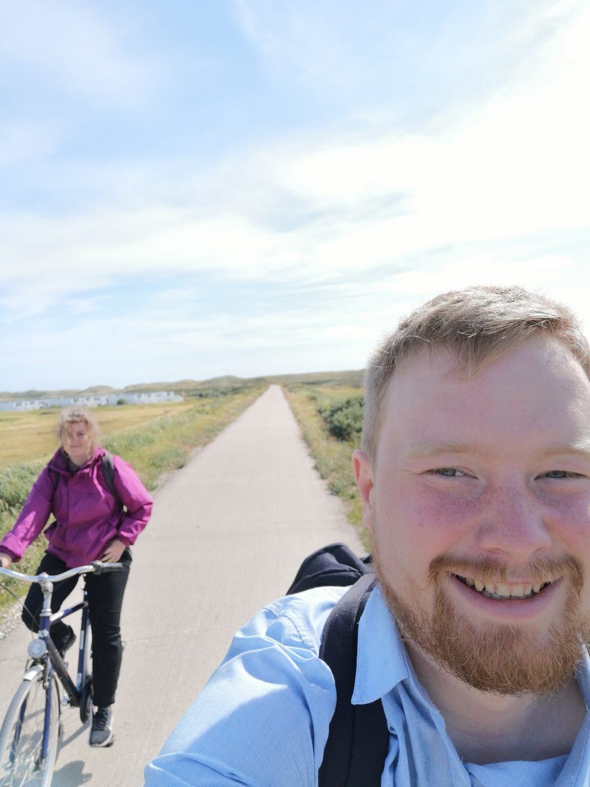
```
]

???
⏱ 0.5 / 5.5 / 26
- Personal hook; keep it to 30 seconds.

---
name: thyboron
class: center
# More pictures

.pull-left[
```{r echo=FALSE, out.width="100%"}
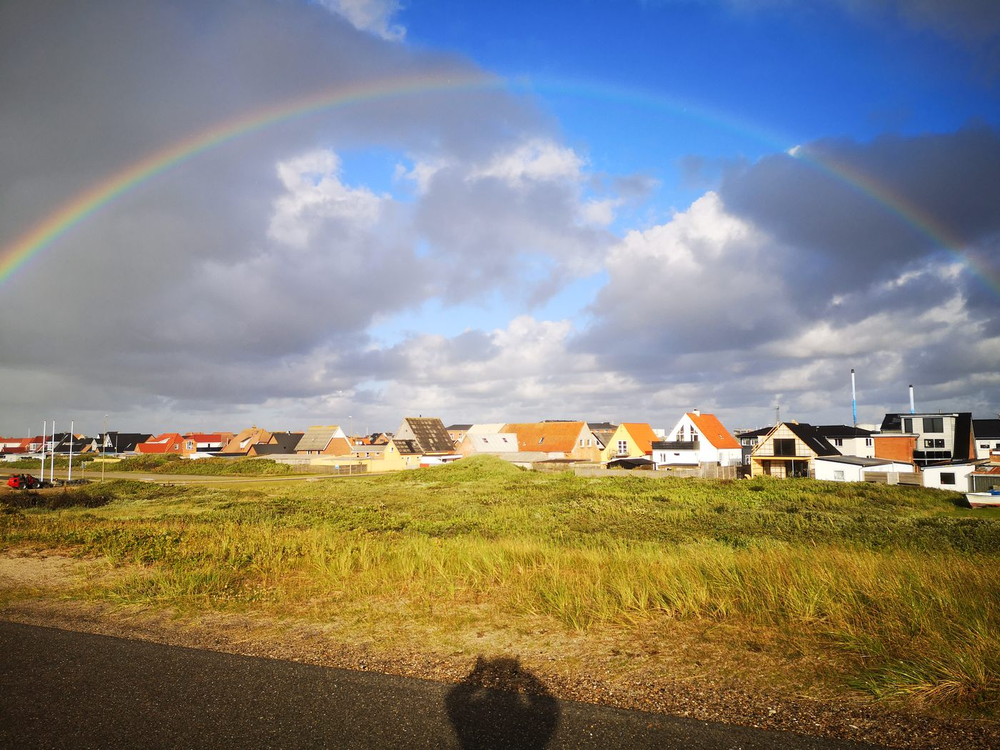
```
]

.pull-right[
```{r echo=FALSE, out.width="70%"}
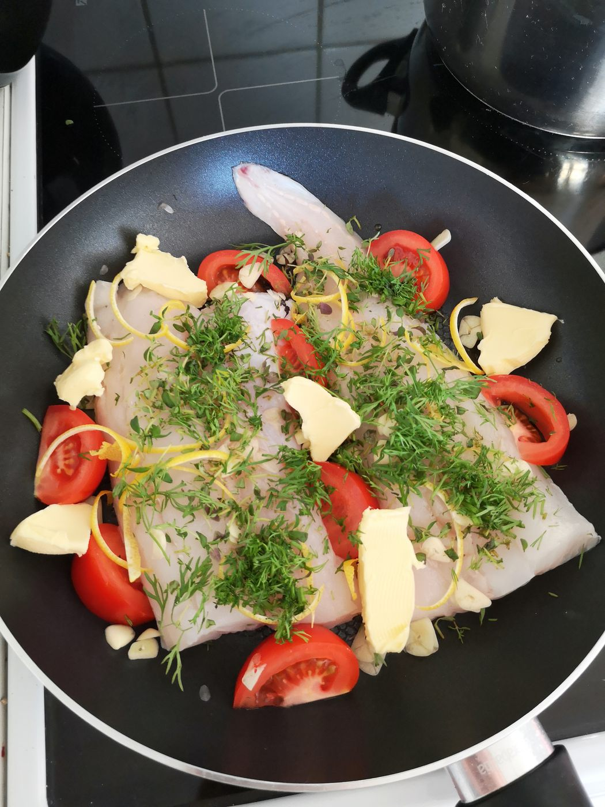
```
]

???
⏱ 0.5 / 6 / 25
- The town on the channel opened by the 1862 storm — a fishing port today.

---
name: pillars
class: middle
# Two pillars

```{r echo=FALSE, out.width="88%", fig.align='center'}
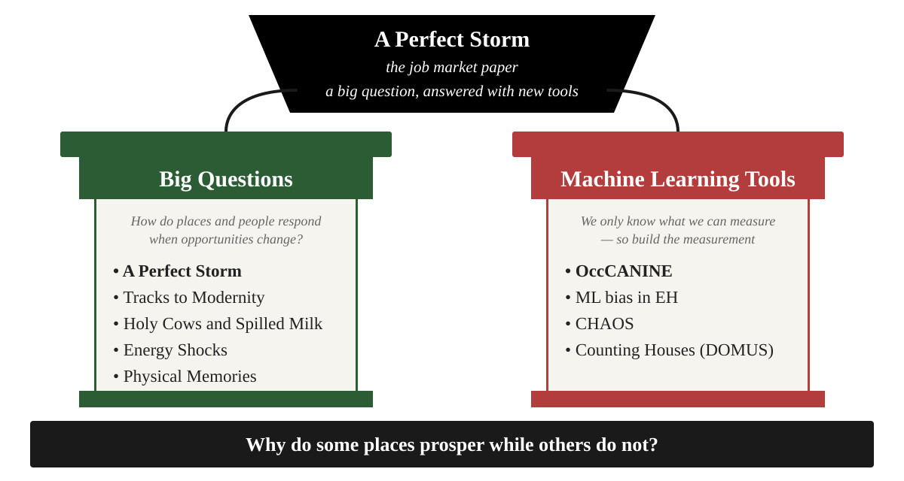
```

???
⏱ 0.5 / 6.5 / 24
- Applications answer the big question; the tools make them possible. Today's paper sits on top of both.

---
name: nightlights
class: left, bottom, hide-logo
background-image: url(Figures/The_earth_at_night_greyscale.png)
background-size: cover
background-position: center

.overlay-box[
### Henderson et al. (2018)
- 24 first-nature attributes explain **47%** of the variation in night lights
- Can we observe the **dynamics** of this happening?
- What if we **randomly changed** first nature?
]

.overlay-credit[
NASA Earth Observatory (2012), via Wikimedia Commons
]

???
⏱ 1 / 7.5 / 23
- Geography is hard to study because it doesn't move. Here it moved — twice.

---
name: literature
# Where this paper fits

.panelset[
.panel[.panel-name[Geography vs institutions]

.pull-left[
`r fontawesome::fa("landmark", height = "2.2em", fill = "#2c4f8a")`

### Institutions
Acemoglu, Johnson & Robinson (2001); Rodrik, Subramanian & Trebbi (2004)
]

.pull-right[
`r fontawesome::fa("mountain", height = "2.2em", fill = "#2c5c34")`

### Geography
Henderson et al. (2018); Bleakley & Lin (2012); Diamond (1997)
]

**The gap:** geography rarely moves — so its effect is hard to separate from what grew around it.
]

.panel[.panel-name[First vs second nature]

.pull-left[
`r fontawesome::fa("water", height = "2.2em", fill = "#2c4f8a")`

### First nature
Coasts, rivers, soil — **what places are given**

.small123[Shifting rivers and routes in the ancient world: Seror (2020); Bakker et al. (2021); Allen et al. (2023)<br>
Single channels: soil (Andersen et al., 2016); coal (Fernihough & O'Rourke, 2020); fish (Dalgaard et al., 2020)]
]

.pull-right[
`r fontawesome::fa("industry", height = "2.2em", fill = "#b33d3d")`

### Second nature
Ports, railways, density — **what people build**

.small123[The Berlin Wall: Redding & Sturm (2008); Ahlfeldt et al. (2015)<br>
Railroads and canals: Donaldson & Hornbeck (2016); Maurer & Rauch (2022)]
]

Bosker (2022) calls for natural experiments. **Here, a storm moved first nature.**
]
]

???
⏱ 1.5 / 9 / 22
GEOGRAPHY VS INSTITUTIONS tab:
- Large shocks wash out (Davis & Weinstein, 2002) or persist through path dependence (Bleakley & Lin, 2012). Deep-history first nature: Allen et al. (2023); Matranga (2024).

FIRST VS SECOND NATURE tab:
- "Think of the Berlin Wall papers — but the wall here is a sand bar, and nature moved it, in both directions."
- Terms: Cronon (1991), Krugman (1993). Other second-nature shocks: wartime bombing (Davis & Weinstein, 2002), railways, canals.
END OF LAYER 2 (by minute 9).

---
name: setting
class: left, bottom
background-image: url(Figures/smidth_fur_marked_KMS7589.jpg)
background-size: cover

.overlay-box[
## The Limfjord: Brief historical background

A protected inland sea — with one exit, until 1825.
]

.overlay-credit[
Hans Smidth, *Fur marked* (1860–1900). SMK, KMS7589, public domain.
]

.map-inset[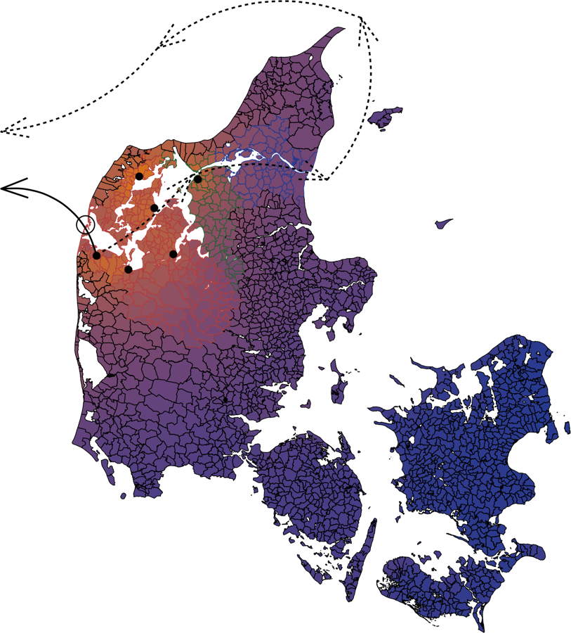]

???
⏱ 0.5 / 9.5 / 21
- Fur is an island in the Limfjord — a market there in the decades after the opening.
- LAYER 3 starts (minute 9): one full pass, to minute 18.5.

---
name: timeline
# Timeline

.pull-left-wide[
#### Pre-event
- **1086–1208:** the western outlet silts shut (land rise since the last ice age); the west Limfjord becomes a dead end
- **1672:** Aalborg, in the east, is Denmark's second-largest town; the other Limfjord towns lag far behind
]

.pull-right-narrow[
```{r echo=FALSE, out.width="100%"}
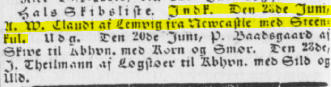
```

.small123[*Local newspaper: a ship arrives with coal from Newcastle*]
]

--

.pull-left-wide[
#### Event
- **1825:** a storm breaches the Agger Isthmus; **1825–28:** a fish windfall in the brackish fjord
- **1834:** ships pass regularly through the new, natural channel
- **1841:** independent trading rights for west Limfjord market towns
- **1840s–60s:** new ports, a steam route to England, the canal at Løgstør (1861)
- **1860–1901:** stronger growth
]

???
⏱ 2 / 11.5 / 20
- Modelled on the PhD defence timeline slide.
- The decree is 1841, seven years after navigability. The claim is that the *geography* moved exogenously, twice — not that nobody responded.
- Answers "why the lag?": the geography moved on its own; realising its value took a generation of adaptation.

---
name: divider-data
class: inverse, center, middle

# Data and empirical strategy

???
⏱ 0 / 11.5 / — (divider, not counted in slides left)

---
name: data-census
# Population and occupations: the census

.pull-left-wide[
- **Link Lives** census microdata, **1787–1901**, aggregated to **1,589 parishes** with consistent borders
- Outcomes: population, **occupations**, **child–woman ratio**, born in another county
- **Occupations come as free text** ⇒ a tool I built: **OccCANINE**

.small123[
| Census entry | | HISCO |
|:--|:--|:--|
| *Huusmand og Fisker* | cottager and fisherman | 62105 + 64100 |
| *Huusmand lever af sin Jordlod* | cottager, lives off his plot | 61115 |
| *Inderste og Dagleier* | lodger and day labourer | 99920 |
| *Væversvend* | journeyman weaver | 75400 |
| *Skipper* | ship's master | 04217 |
]
]

.pull-right-narrow[
```{r echo=FALSE, out.width="62%"}
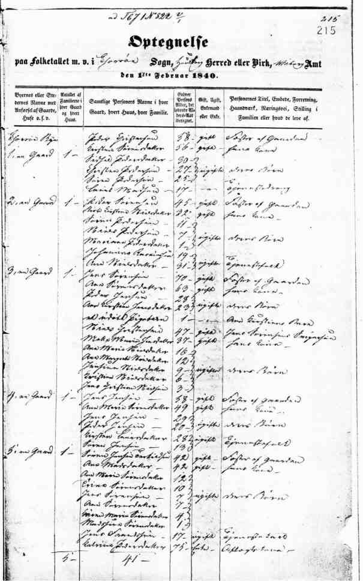
```

.small123[*The 1840 census (Wikimedia Commons, public domain)*]
]

???
⏱ 0.5 / 12 / 19
- Without the tool, no occupational results. Explain in one breath, then move on.
- Examples are real Danish census entries from the OccCANINE validation data (DK census), shown with OccCANINE's HISCO codes. One entry can hold two occupations.

---
name: occcanine
# A tool this paper needed: OccCANINE

.chaosred[**A separate paper:** *Breaking the HISCO Barrier* — Dahl, Johansen & Vedel — [arXiv 2402.13604](https://arxiv.org/abs/2402.13604)]

.pull-left-wide[
- Maps free-text occupational descriptions to **HISCO** codes, in **13 languages**
- Fine-tuned on **15.8 million** description–code pairs from 29 sources; **96%** accuracy
- Open source: **9,348+** downloads
- EHES WP 255; R&R *Explorations in Economic History*
]

<br>

```{r echo=FALSE, out.width="80%", fig.align='center'}
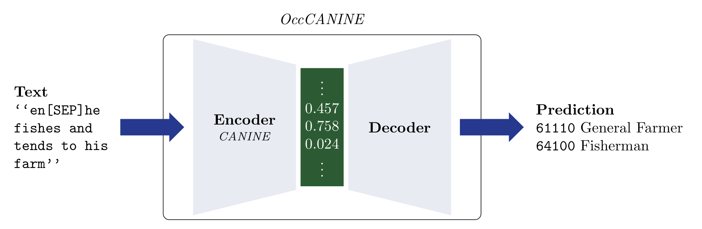
```

???
⏱ 0.5 / 12.5 / 18

---
name: occcanine-architecture
# How OccCANINE works

.chaosred[**A separate paper:** *Breaking the HISCO Barrier* — Dahl, Johansen & Vedel — [arXiv 2402.13604](https://arxiv.org/abs/2402.13604)]

```{r echo=FALSE, out.width="72%", fig.align='center'}
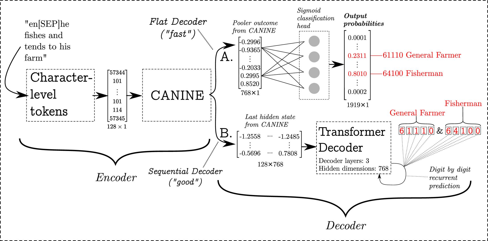
```

.footnote[.small123[Character-level encoder (CANINE) with two decoders: a flat classifier ("fast") and a sequential, digit-by-digit transformer decoder ("good").]]

???
⏱ 0.5 / 13 / 17

---
name: occcanine-census
# OccCANINE enabled this project

```{r echo=FALSE, out.width="88%", fig.align='center'}
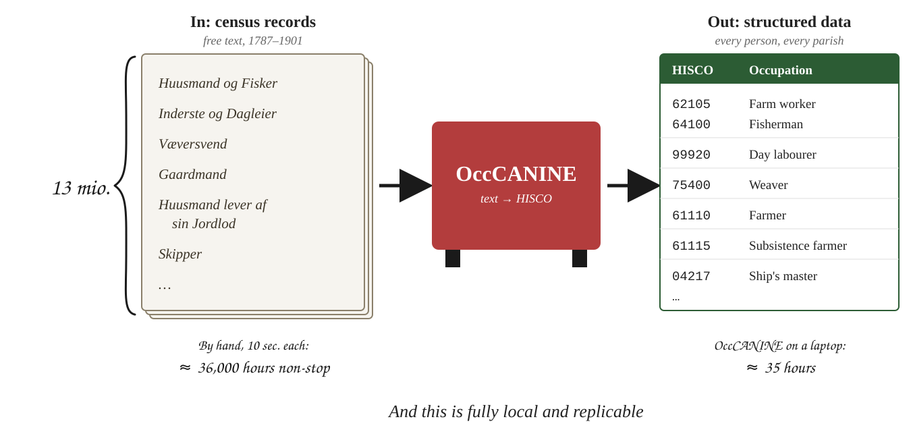
```

???
⏱ 0.5 / 13.5 / 16
- Every occupational description in the Danish censuses, 1787–1901, goes in as free text; HISCO codes come out.
- The examples are real census entries (see the census slide). One entry can hold two occupations.
- Time: by hand at 10 sec. per record (the benchmark in Breaking the HISCO Barrier): 13 mio. x 10 s = 36,000 hours of non-stop work (about 4 years round the clock; 22 work-years at 1,650 h/year).
- OccCANINE (paper benchmark, laptop with NVIDIA Quadro T2000 4GB): 10,000 records in 1 min 38 s (flat decoder) => 13 mio. in ~35 hours. Sequential decoder: 8 min 56 s per 10,000 => ~8 days.

---
name: data-str
# Trade: the Sound Toll registers

.pull-left[
- Every ship passing Elsinore, **1497–1857** — 1.8 million passages
- Digitised by the University of Groningen (Veluwenkamp & Woude)
- Ships from Limfjord ports, by part of the fjord: west, middle, east
- Eastbound trade only: the westward route bypasses Elsinore
]

.pull-right[
```{r echo=FALSE, out.width="85%"}
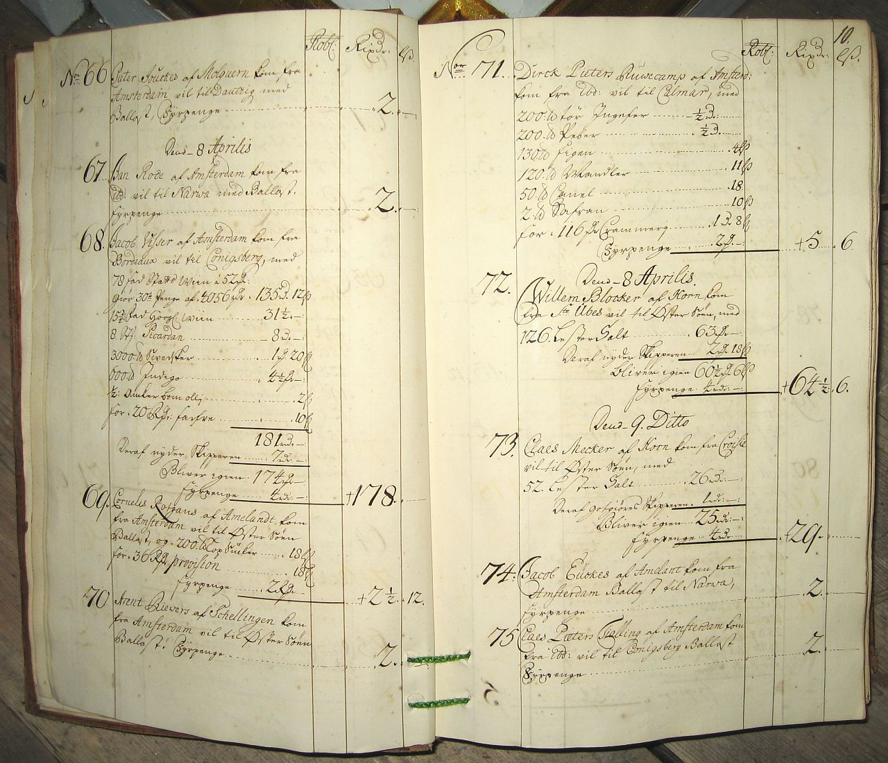
```

.small123[*A page from the Sound Toll Register, 1734 (rug.nl)*]
]

???
⏱ 0.5 / 14 / 15

---
name: strategy
class: middle
# Empirical strategy

.pull-left[
.small123[
$$\log(y_{it}) = \sum_{t} \beta_t \, Affected_i \times Year_t + \alpha_i + \delta_t + \varepsilon_{it}$$
]

*Affected* is either
- **Dummy:** parish in the west Limfjord, or
- **Market access:** change in log market access after the breach

```{r echo=FALSE, out.width="70%", fig.align='center'}

```
]

.pull-right[
.small123[
$$MA_i = \sum_{h \in \mathcal{H}} CostDist(i,h)^{\theta}, \quad \theta = -1$$
]

- Least-cost paths over land and sea to **126 Danish ports**; land 10× sea
- **Identification:** absent the storm, affected parishes would have trended like other Danish parishes
]

???
⏱ 2 / 16 / 14

---
name: divider-results
class: inverse, center, middle

# Results

???
⏱ 0 / 16 / — (divider, not counted in slides left)

---
name: trade
# Trade followed the geography

.pull-left-wide[
```{r echo=FALSE, out.width="100%"}
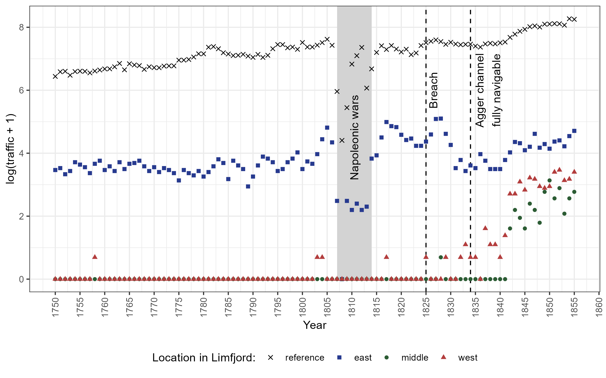
```
]

.pull-right-narrow[
- **Sound Toll registers:** 1.8 million passages through the Øresund, 1497–1857
- West and middle Limfjord ports **appear after the opening** and grow after the **1841** trading rights
- No comparable break for East Limfjord (Aalborg) or the reference series

[Regression table](#trade-table) · [Ships through the channel](#channel-traffic)
]

???
⏱ 1 / 17 / 13
- Main trade result. Be upfront: these are eastbound passages; part of the growth follows the 1841 rights.
- Direct westward evidence (ships through the channel itself) is in the deep dives.

---
name: pop
# Population: +27% within a generation

.pull-left[
```{r echo=FALSE, out.width="86%"}
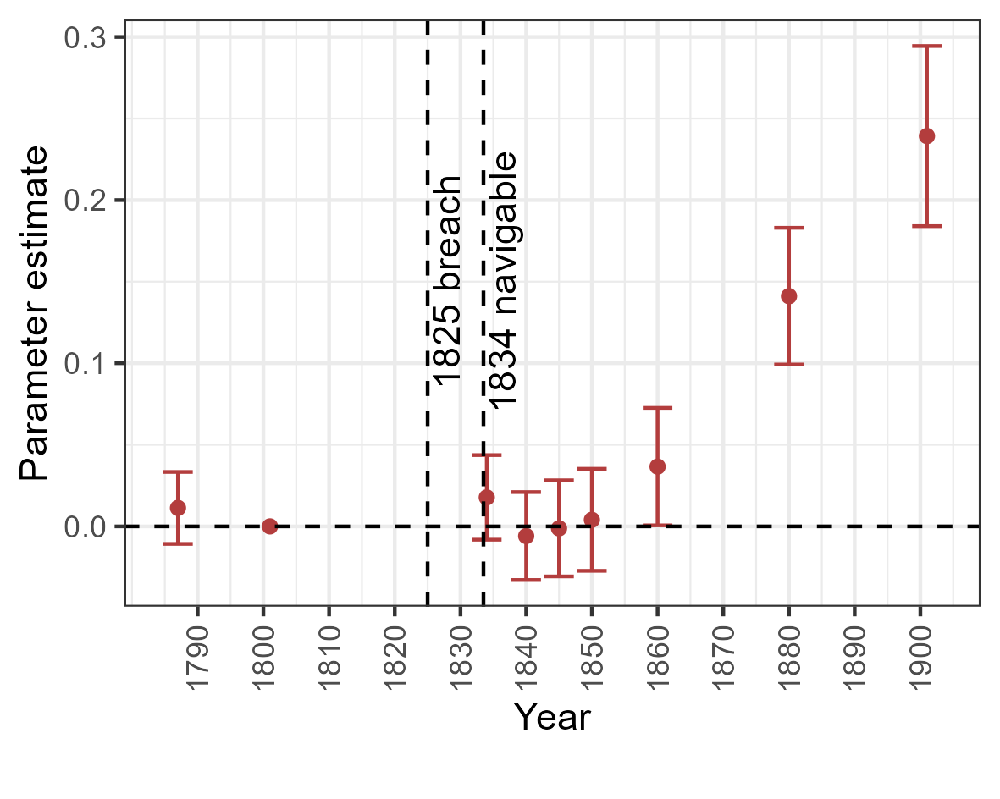
```

.small123[*Dummy approach*]
]

.pull-right[
```{r echo=FALSE, out.width="86%"}
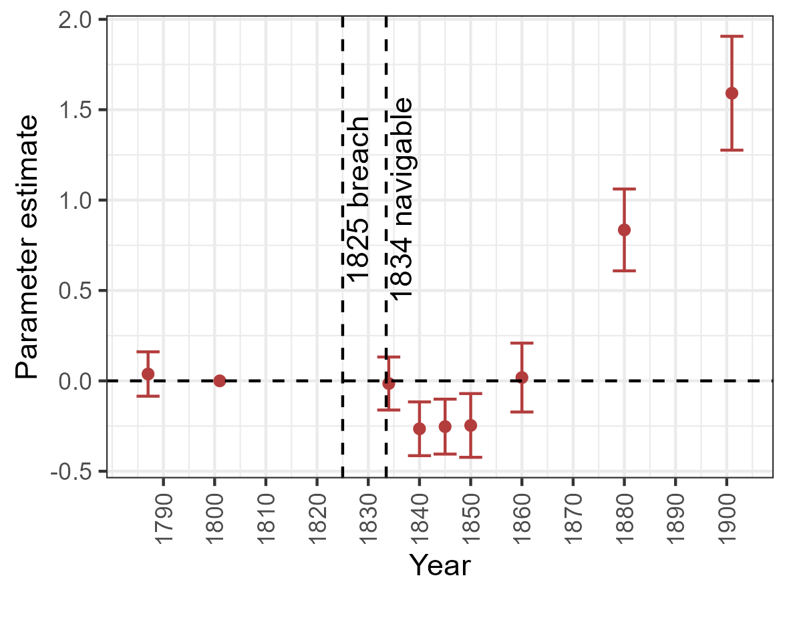
```

.small123[*Market access approach*]
]

.footnote[.small123[No pre-trends (1787, 1801). By 1901: **0.24 log points (27.0%)**; market-access elasticity **1.6**, similar in relative terms to the Panama Canal (Rauch & Maurer).]]

???
⏱ 1.5 / 18.5 / 12

---
name: mechanisms
class: left, top
background-image: url(Figures/kroyer_foundry_KMS3605.jpg)
background-size: cover

.overlay-box[
## Mechanisms

How the local economy changed — and who changed it.
]

.overlay-credit[
P.S. Krøyer, *Fra Burmeister & Wains jernstøberi* (1885). SMK, KMS3605, public domain.
]

???
⏱ 0.5 / 19 / 11
LAYER 4 starts (minute 18.5): mechanisms, then the mirror, to minute 28.
- Industrial work: the kind of production that grew in the west Limfjord (spinners, foundries).

---
name: occupations
# What people did: farming, fishing and production

.pull-left[
```{r echo=FALSE, out.width="92%"}
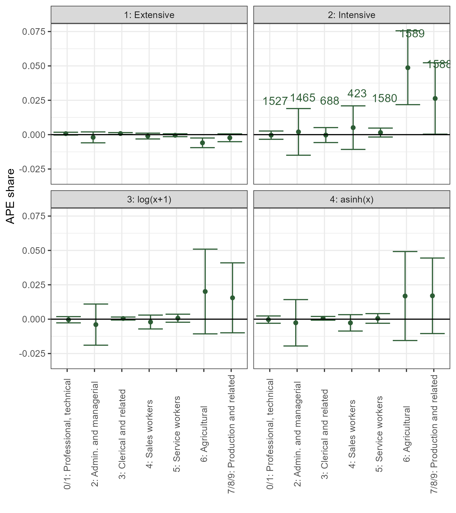
```
]

.pull-right[
- HISCO major groups in **1901** (coded with OccCANINE)
- More **agricultural** (incl. fishing) and **production** workers where these already existed (intensive margin)
- No new occupation types appear (extensive margin)

```{r echo=FALSE, out.width="70%"}
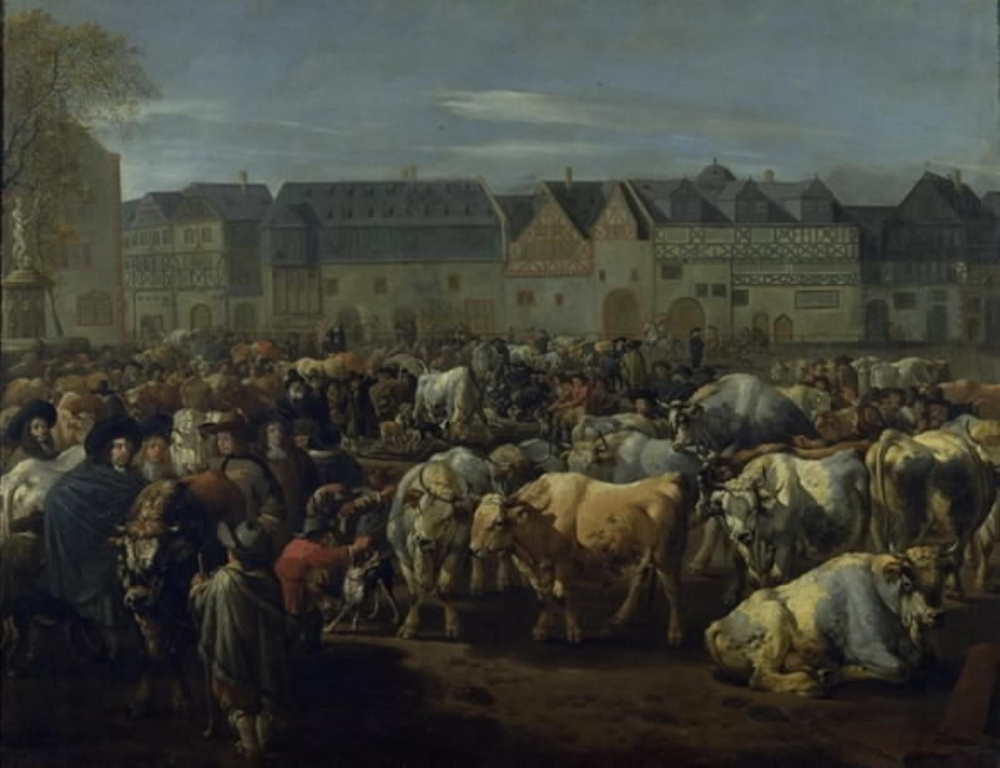
```

.tiny123[Johann Heinrich Roos, *Et kvægmarked* (1676). SMK, KMS4793, public domain.]
]

???
⏱ 1 / 20 / 10

---
name: occ-detail
# Who exactly: fishermen, farmers, spinners

.pull-left-wide[
```{r echo=FALSE, out.width="85%"}
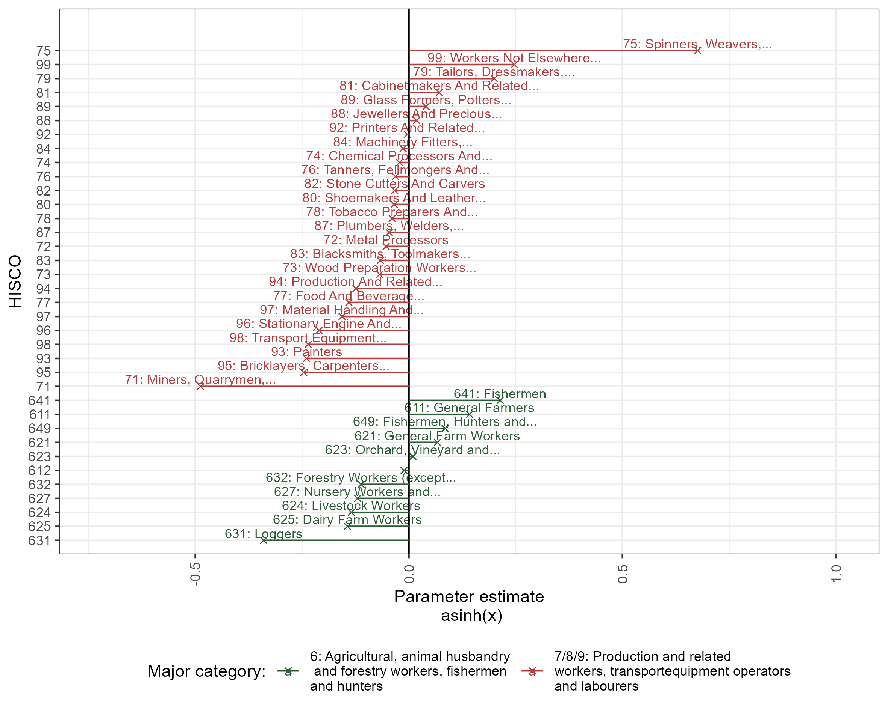
```
]

.pull-right-narrow[
- **Fishermen** and **general farmers** grow
- **Spinners and weavers** grow most among production workers
- [Fishing early, spinning late](#fish-spin)

```{r echo=FALSE, out.width="55%"}
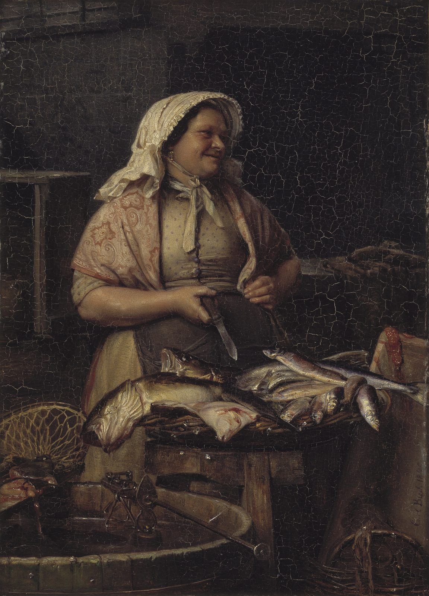
```

.tiny123[Carl Bloch, *En kone, der sælger fisk* (1875). SMK, KMS1085, public domain.]
]

???
⏱ 1.5 / 21.5 / 9

---
name: fertility
# Growth from within: fertility, not migration

.pull-left[
**Child–woman ratio**
```{r echo=FALSE, out.width="80%"}
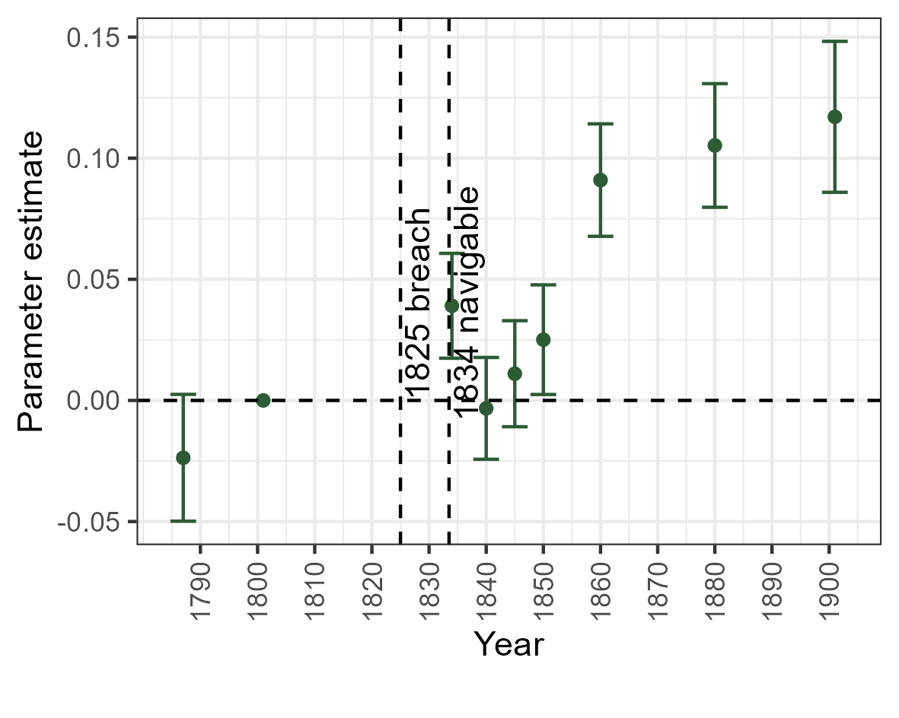
```
]

.pull-right[
**Share born in another county**
```{r echo=FALSE, out.width="80%"}
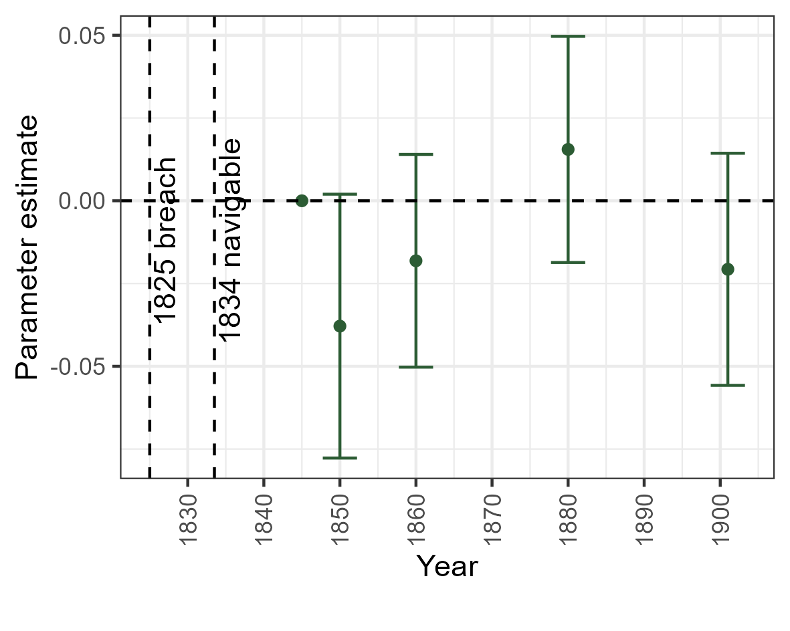
```
]

.footnote[.small123[Child–woman ratio = children 1–5 / women 15–45; captures births *and* early survival. [Market-access versions](#fertility-ma) · [A younger population](#age).]]

???
⏱ 1 / 22.5 / 8
- Post-Malthusian Denmark (Jensen et al. 2022). Don't say "entirely".

---
name: boe
class: title-sm
# Back of the envelope: can fertility explain the observed population growth?

.boe-left.boe-col[
**Setup**

Take the fertility estimates and ask what they imply for population, holding **migration and mortality fixed**.
]

--

.boe-right[
```{r echo=FALSE, out.width="100%"}
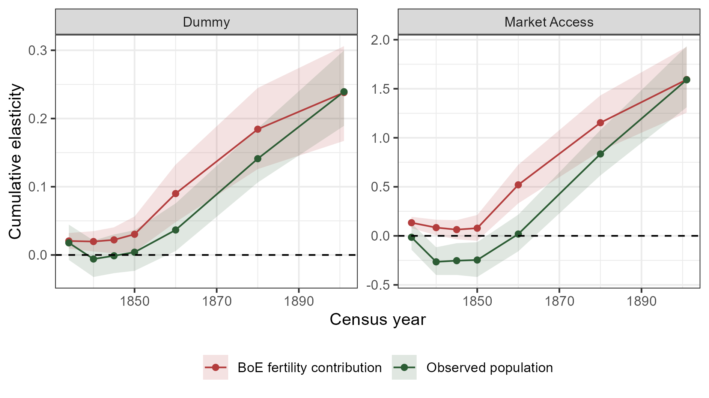
```

.small123[*Red: implied by fertility. Green: observed. Appendix Figure A7*]
]

--

.boe-left.boe-col[
- Diverge before 1860 (the salinity shock)
- **Match by 1901:** 1.59 vs 1.59; 0.238 vs 0.239
- ⇒ fertility accounts for the growth
- Denmark was **post-Malthusian** by then (Jensen et al., 2022): more children suggests higher living standards, a speculative link to prosperity
]

???
⏱ 1.5 / 24 / 7
- Explain the setup BEFORE revealing the figure: the fertility result is a rate, the population result is a stock. A persistent rise in the birth rate compounds into a larger proportional gain in the stock.
- CWR counts children 0–5, so divide by five for an annual rate; multiply by w_f (1801 share of women 15–44 in treated parishes, 0.219, stable over the period); cumulate over inter-census intervals (1825 as left boundary for 1834).
- Post-Malthusian: Jensen, Pedersen, Radu & Sharp (2022, EEH), "Arresting the Sword of Damocles": diminishing returns in Denmark until c. 1775, then the post-Malthusian era. In the paper, higher net fertility signals improved living standards (Jensen 2022; Klemp 2016). Keep it speculative.
- By 1901: market access 1.593 implied vs 1.59 observed; dummy 0.238 vs 0.239 (paper, Appendix "From fertility effect to population effect").

---
name: morso
# A local example: the Morsø foundry

.pull-left-wide[
- **Morsø Jernstøberi**, founded **1853** in Nykøbing Mors, on the Limfjord
- Located where imported **British coal** and **Swedish iron** could now arrive by ship
- Still making cast-iron stoves today
]

.pull-right-narrow[
```{r echo=FALSE, out.width="100%"}
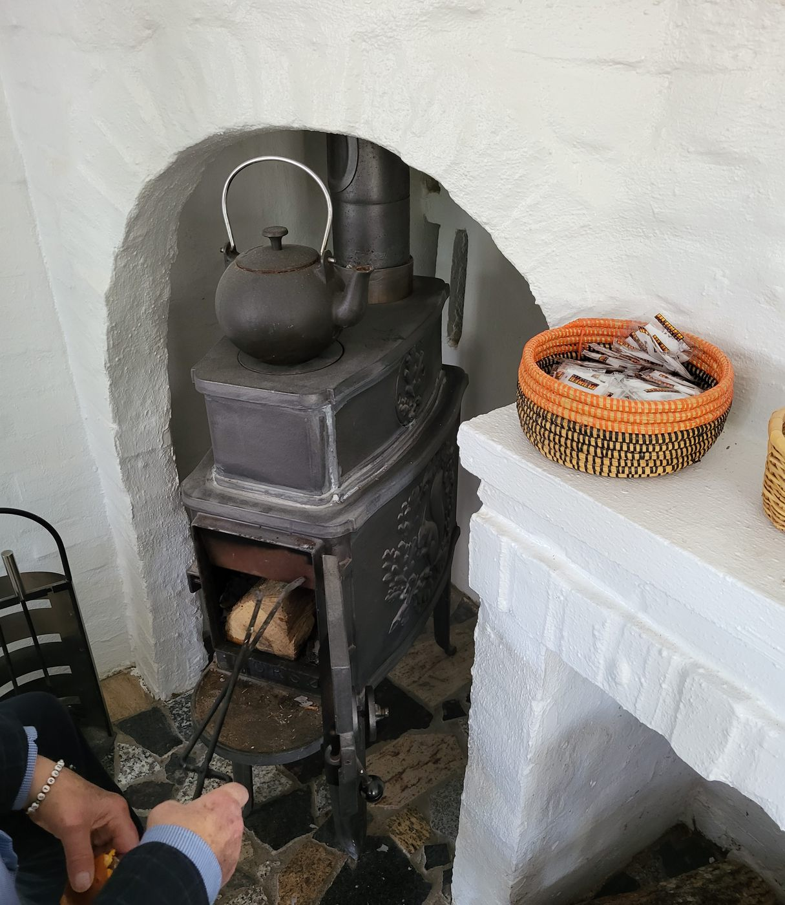
```

.small123[*Private picture from the house where I grew up*]
]

???
⏱ 0.5 / 24.5 / 6

---
name: external-validity
class: left, top, hide-logo
background-image: url(Figures/gislev_hoard_pennies.jpg)
background-size: cover
background-position: center

<br><br><br>

.overlay-box[
## What about external validity?

- Ideally: the **same shock**, in **similar geography**
- …in a society where everything else differs: economy, technology, culture, institutions, religion
]

.overlay-credit[
Pennies from the Gislev Hoard, minted under Erik Menved (1286–1319); Gråbrødrekloster museum, Aalborg. Wmpearl, Wikimedia Commons, CC0.
]

--

.overlay-box.overlay-spoiler[
**I use the exact mirror event in the 12th century**
]

???
⏱ 0.5 / 25 / 5
- The coins hint at what is coming: pennies from the Gislev Hoard (Erik Menved), shown at the Gråbrødrekloster museum in Aalborg, on the Limfjord. Finds like these are the outcome in the mirror.
- Build the tension: the ideal check on external validity is the same shock, same geography, different society.
- Pause before the last bullet; then the next slide shows the mirror: the same channel, closing 700 years earlier.

---
name: mirror
# The mirror: the same channel, closing

.pull-left-wide[
- In the Viking age the Limfjord had **two openings** — a protected shortcut between the North Sea and the Kattegat
- The western outlet **silted shut between 1086 and 1208** (Saxo, historical and geological sources)
- A very different society — other institutions, technology, trade partners. **Same geography**
- Outcome: probability of **coin** and **building** finds over time

```{r echo=FALSE, out.width="62%"}
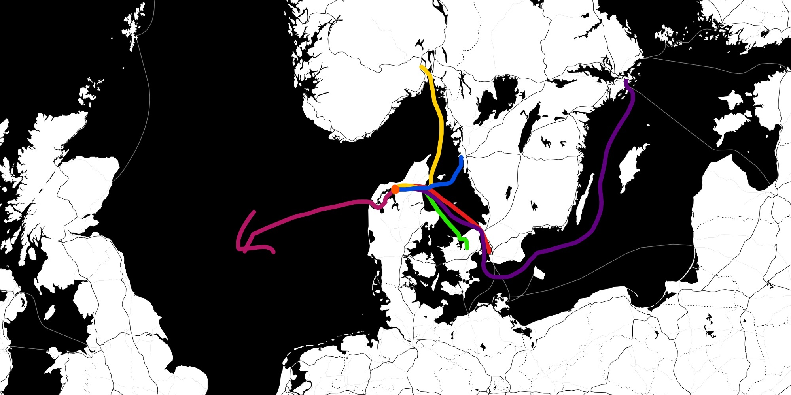
```
]

.pull-right-narrow[
```{r echo=FALSE, out.width="100%"}
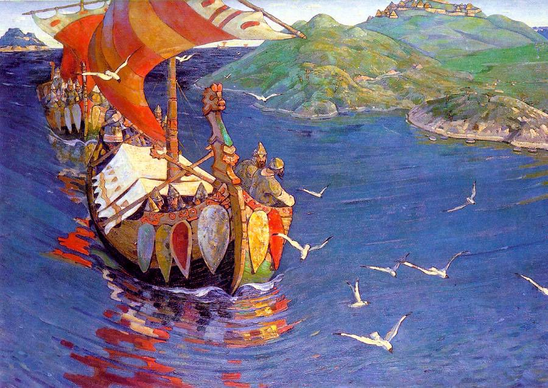
```

.tiny123[Nicholas Roerich, *Guests from Overseas* (1901). Wikimedia Commons, public domain.]

]

???
⏱ 1 / 26 / 4

---
name: arch-descriptive
# Coin finds by region, before any adjustment

.pull-left-wide[
```{r echo=FALSE, out.width="88%", fig.align='center'}
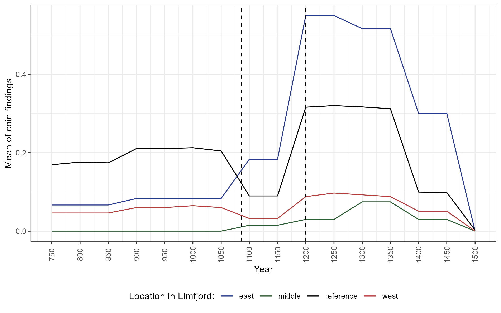
```
]

.pull-right-narrow[
```{r echo=FALSE, out.width="100%"}
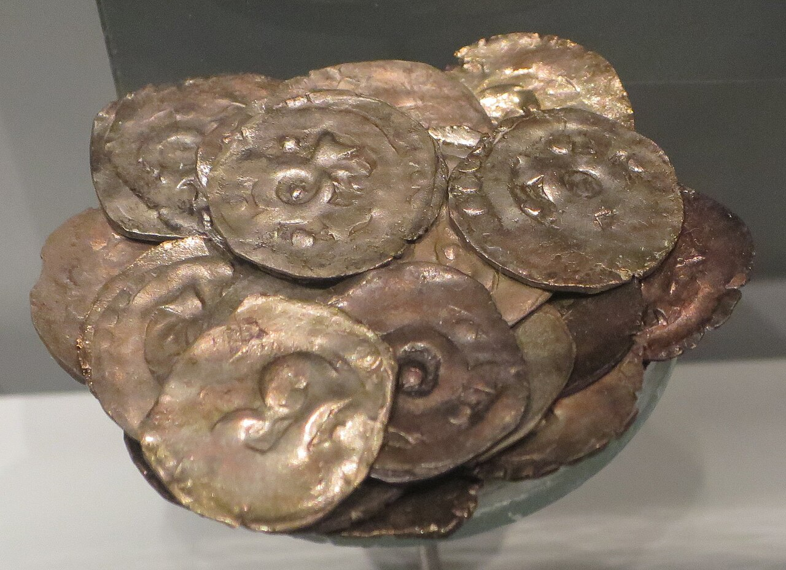
```

.tiny123[Pennies from the Gislev Hoard, minted under Erik Menved (1286–1319); Gråbrødrekloster museum, Aalborg. Wmpearl, Wikimedia Commons, CC0.]
]

.footnote[.small123[Raw counts: after the closure, the East Limfjord and the rest of Denmark grow while the West and Middle stagnate. But raw counts over-weight finds with wide date ranges — next slide.]]

???
⏱ 0.5 / 26.5 / 3

---
name: arch-source
# Measuring the medieval economy

.eq150[
$$\underbrace{P(\text{find in parish } i \mid t)}_{\text{what we want: activity in year } t} = 1 - \prod_{c=1}^{K_i}\Big(1 - \underbrace{P(t \mid c)}_{\text{what we have: date range of find } c}\Big)$$
]

.pull-center-wide[
- **Bayesian intuition:** a museum dates a coin to *1300–1535* — that is *P*(*t* | *c*), how likely each year is *given the find*. We invert it into how likely the parish *produced a find in year* *t*
- **Source:** *Fund og Fortidsminder* — 3,411 coins (trade) and 4,396 buildings (settlement), 750–1500; Monte Carlo draws, bootstrapped standard errors
- Parishes **matched on soil type**
]

.footnote[.small123[Finds as economic data: Ortman & Lobo (2020); Barjamovic et al. (2019); Bakker et al. (2021); Allen et al. (2023); Boehm & Chaney (2024). [Estimator](#arch-estimator) · [Matching](#arch-matching)]]

???
⏱ 0.5 / 27 / 2
- Same approach in economics (paper, footnote and Section 4): Barjamovic, Chaney, Coşar & Hortaçsu (2019, QJE); Bakker, Maurer, Pischke & Rauch (2021); Allen, Bertazzini & Heldring (2023); Boehm & Chaney (2024). Settlement scaling: Ortman & Lobo (2020, Science Advances).
- Naive approach: a 1 in every year of the range — over-weights the vaguest finds (the descriptive figure).
- Instead treat each range as a distribution; the product term is the probability that *none* of the parish's K finds dates to t, so one minus it is the probability of at least one.

---
name: arch
# Closure ⇒ decline

.pull-left[
```{r echo=FALSE, out.width="90%"}
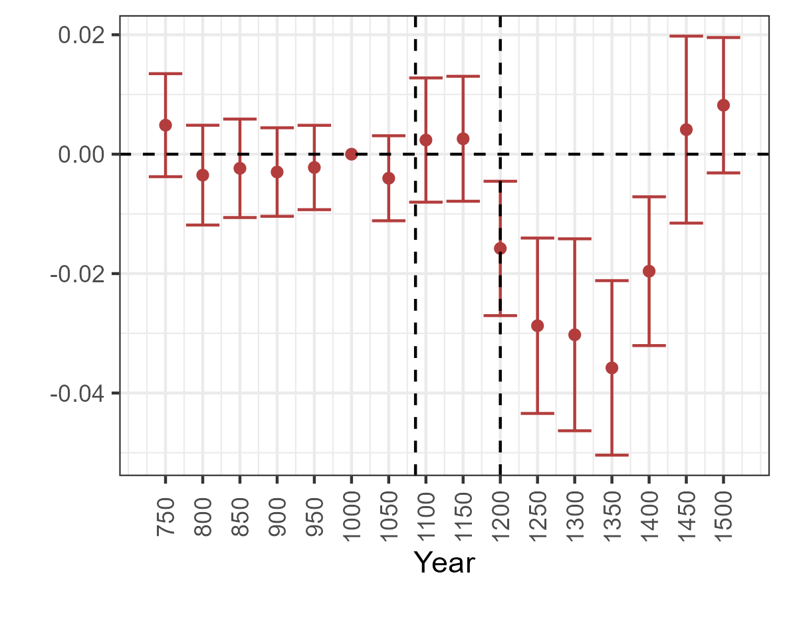
```

.small123[*Coin finds*]
]

.pull-right[
```{r echo=FALSE, out.width="90%"}
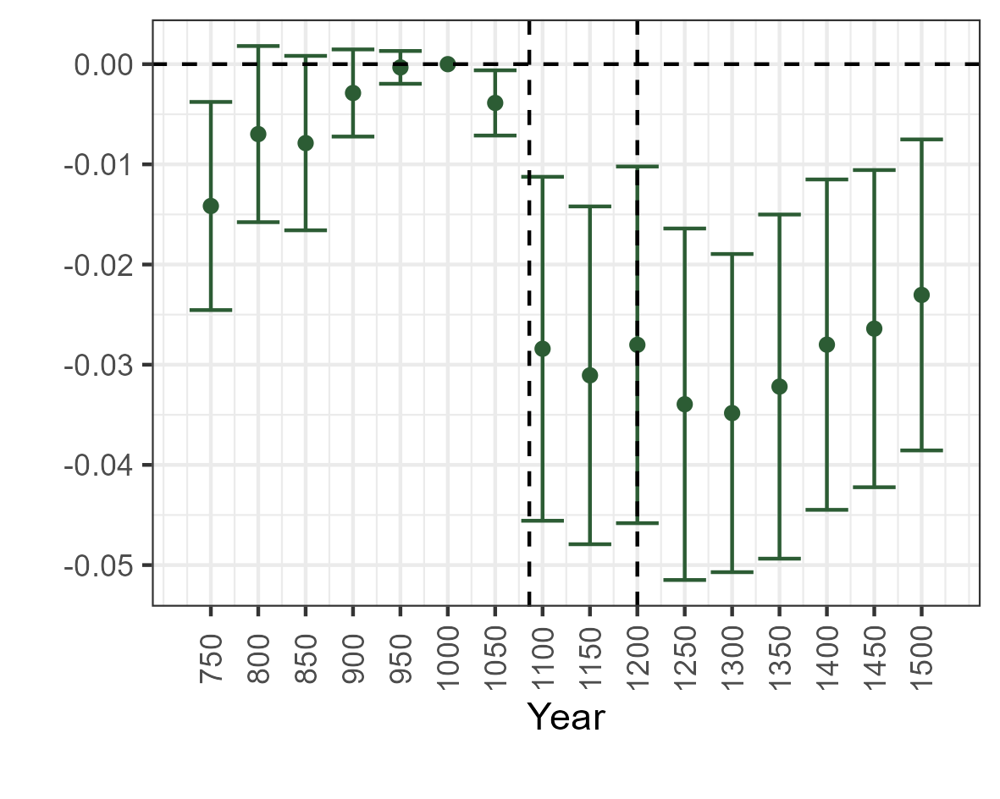
```

.small123[*Building finds*]
]

.footnote[.small123[Building finds fall from c. 1100; coin finds from c. 1200 and recover after 1400. [Market-access versions](#arch-ma).]]

???
⏱ 1 / 28 / 1
End of the mirror experiment.

END OF LAYER 4 (by minute 30).
- Q&A prep (threats slide dropped 2026-10-20): trading rights 1841 and new ports are part of the response; navigability from erosion, Thyborøn from a second storm; estimates are relative (some re-routing from Aalborg), and the mirror shows the reverse. Also: dune maintenance, Copenhagen in market access, spillovers, spatial standard errors.

---
name: programme
class: left, middle, hide-logo
background-image: url(Figures/ai_enlightenment.jpg)
background-size: contain
background-color: #07090d

.overlay-box.overlay-narrow[
## Other work and future agenda

Measuring what people had — and what they thought.
]

.overlay-credit[
AI-generated illustration.
]

???
LAYER 5 (by minute 60).

---
name: ongoing
# Other work

.pull-left[
**Published**
- [**Holy Cows and Spilled Milk**](#proj-holycows) — Weber, missions and firm productivity (*J. Development Economics*, 2026)
- [**Adaptability, Diversification and Energy Shocks**](#proj-energy) — peat, coal and creameries (*Energy Economics*, 2024)

**Working papers**
- [**OccCANINE**](#occcanine) — R&R *Explorations in Economic History*
- [**ML bias in EH**](#ml-bias)
- [**Tracks to Modernity**](#proj-tracks) — R&R *European Review of Economic History*
- [**Physical Memories and the Far Right**](#proj-farright)
]

.pull-right[
**In progress**
- [**CHAOS**](#proj-chaos) — occupational incomes from scattered evidence
- [**Counting Houses**](#proj-domus) — population from historical town maps
- [**Copenhagen Tax Books**](#proj-copenhagen) — incomes, 1862–1918
- **Occupations Past** — [occupationspast.org](https://www.occupationspast.org/)

**Plans**
- [**Trade Liberalisations**](#proj-freedom) — freedom of trade and the Danish economy (funded)
- [**Agenda**](#agenda) — what they had and what they thought
]

???
- Click any title for its slides in the appendix; each has a link back here.

---
name: agenda
# Agenda: what they had and what they thought

.pull-left-narrow[
```{r echo=FALSE, out.width="100%"}
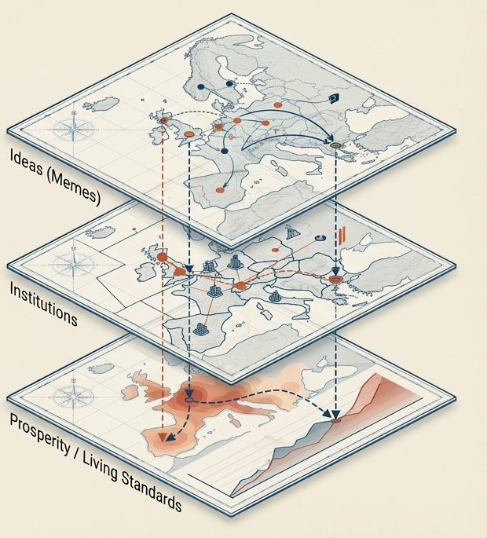
```

.tiny123[AI-generated illustration.]
]

.pull-right-wide[
1. **Living standards from categorical records** — incomes, inequality and population from occupations and historical maps, with a correction for classifier confusion
2. **Ideas as measurable objects** — estimate idea-classes from text and track their diffusion
3. **The European network** — trade routes (Sound Toll, Hanse, coins) as the channels along which goods and ideas travelled

> *Europe, 1600–1900, on one map and one timeline — released as open data and tools.*
]

???
- Three strands, not a list of papers. Ideas layer, institutions layer, living-standards layer — the picture.

---
name: conclusion
# Conclusion

.pull-left-wide[
- A storm moved the geography; **trade followed**, and a generation later **population (+27%)** and more **farmers, fishermen and textile workers**, driven by **fertility**
- The **same channel closing** 700 years earlier produced the mirror image
- *In an age of climate change, we want to understand how the landscape affects the location of development and prosperity*
]

.pull-right-narrow[
**Email:** [cvedel.eh@gmail.com](mailto:cvedel.eh@gmail.com)<br>
**Website:** [christianvedels.github.io](https://christianvedels.github.io/)<br>
**Twitter/X:** [@ChristianVedel](https://twitter.com/ChristianVedel)<br>
**BlueSky:** [@christianvedel.bsky.social](https://bsky.app/profile/christianvedel.bsky.social)

```{r echo=FALSE, out.width="78%"}

```
]

.footnote[.small123[**Working paper:** Vedel, *A Perfect Storm*, [arXiv 2408.00885](https://arxiv.org/abs/2408.00885) (EHES WP 262). Full replication package available at [github.com/christianvedels/A_perfect_storm](https://github.com/christianvedels/A_perfect_storm).]]

???
⏱ 2 / 30 / 0
Target of the secret logo link.

---
name: deep-dives
class: left, bottom
background-image: url(Figures/clemens_workshop_KMS1457.jpg)
background-size: cover

.overlay-box[
## More detail
]

.overlay-credit[
G.A. Clemens, *Gårdinteriør fra en maskinfabrik i en provinsby* (1892). SMK, KMS1457, public domain.
]

???
LAYER 6 — deep dives, only on request.

---
name: proj-holycows
# Holy Cows and Spilled Milk
### Does religion shape economic life? Weber's question, without the confounders

.pull-left-wide[
- **Weber (1905):** the Protestant ethic and the spirit of capitalism — religion as a driver of economic behaviour
- **Development economics:** missions in today's developing countries are credited and blamed for a lot — human capital, health, values (Nunn 2010; Cagé & Rueda 2016; Valencia Caicedo 2019)
- **The problem:** missionaries were Westerners in colonial settings who also brought schools, printing presses and science — so the *religious* effect is never isolated
- **Our test:** a revivalist mission *inside* a homogeneous Protestant society, with no colonial or cultural confounders
]

.pull-right-narrow[
> *"It is a question of heaven or hell…"* <br>— *"And then I thought that heaven was the more comfortable place to be."*

.small123[Missionary and dairy farmer (Haue, 1978)]
]

.footnote[.small123[**Published:** Bentzen, Boberg-Fazlić, Sharp, Skovsgaard & Vedel, *Journal of Development Economics* 179 (2026), [doi:10.1016/j.jdeveco.2025.103651](https://doi.org/10.1016/j.jdeveco.2025.103651). [Back to other work](#ongoing)]]

---
name: holycows-design
# Holy Cows and Spilled Milk
### Setting and identification

.pull-left[
- Denmark c. 1900: rapid industrialisation through **964 cooperative creameries**
- The pietist **Inner Mission** spread from 1872; productivity = milk needed per unit of butter
- **Shift-share design:** local mission-house density in **1890** (the early houses) × the **national** expansion of the movement
- Robustness: exposure to the controversial preacher **Carl Moe**
]

.pull-right[
```{r echo=FALSE, out.width="88%"}
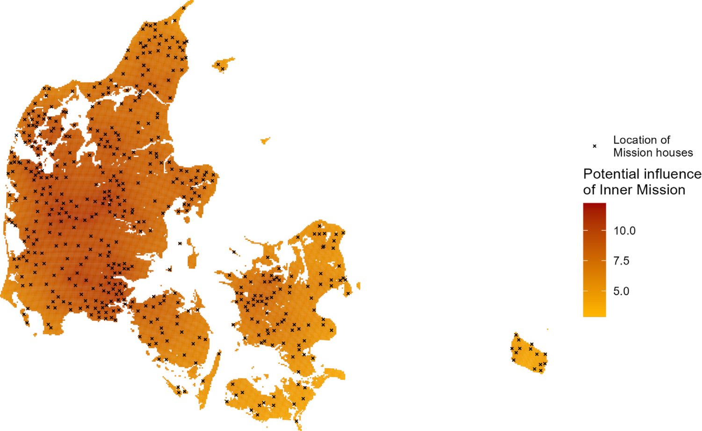
```

.small123[*Potential influence of the Inner Mission*]
]

.footnote[.small123[**Published:** Bentzen, Boberg-Fazlić, Sharp, Skovsgaard & Vedel, *Journal of Development Economics* 179 (2026), [doi:10.1016/j.jdeveco.2025.103651](https://doi.org/10.1016/j.jdeveco.2025.103651). [Back to other work](#ongoing)]]

---
name: holycows-results
# Holy Cows and Spilled Milk
### Mission intensity lowered productivity

.pull-left[
```{r echo=FALSE, out.width="78%"}
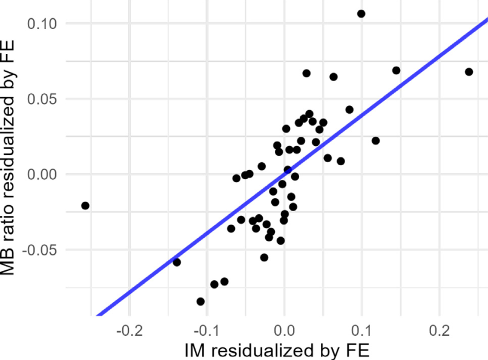
```

.small123[*Milk-to-butter ratio against mission intensity (higher = less efficient)*]
]

.pull-right[
- Loss ≈ **7.5% of dividends** to farmer-shareholders (≈ 23,500 2010 USD for the median creamery)
- **Sunday closures** broke the economies of scale of daily milk processing
- **Doctrinal splits:** Sabbatarian farmers left to found their own creameries
- Religiosity itself — not colonialism or Western technology — constrained firms
]

.footnote[.small123[**Published:** Bentzen, Boberg-Fazlić, Sharp, Skovsgaard & Vedel, *Journal of Development Economics* 179 (2026), [doi:10.1016/j.jdeveco.2025.103651](https://doi.org/10.1016/j.jdeveco.2025.103651). [Back to other work](#ongoing)]]

---
name: proj-energy
# Adaptability, Diversification and Energy Shocks
### When the coal stopped coming

.pull-left[
- Danish industry ran almost entirely on **British coal**
- From 1917 coal became scarce and expensive into the 1920s
- Local alternative: **peat** — but only near freshwater deposits
- Micro data on butter factories, **1900–1928**
]

.pull-right[
```{r echo=FALSE, out.width="90%"}
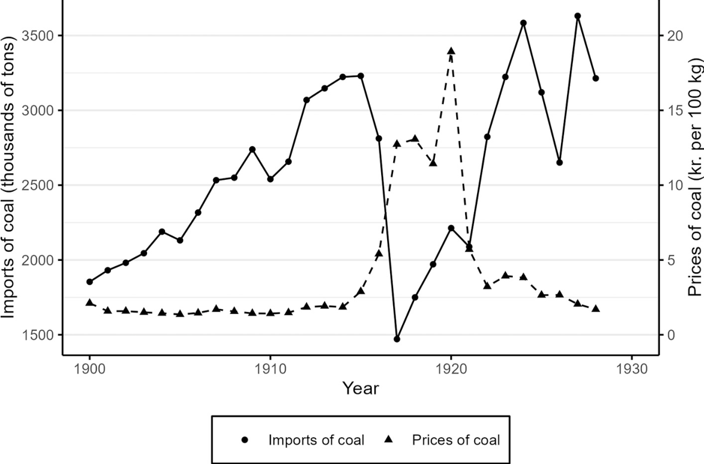
```

.small123[*Coal imports and prices, 1900–1928*]
]

.footnote[.small123[**Published:** Henriques, Sharp, Tsoukli & Vedel, *Energy Economics* 139 (2024), [doi:10.1016/j.eneco.2024.107887](https://doi.org/10.1016/j.eneco.2024.107887). [Back to other work](#ongoing)]]

---
name: energy-results
# Adaptability, Diversification and Energy Shocks
### Firms that could switch fuels did better — and kept the gains

.pull-left[
```{r echo=FALSE, out.width="90%"}
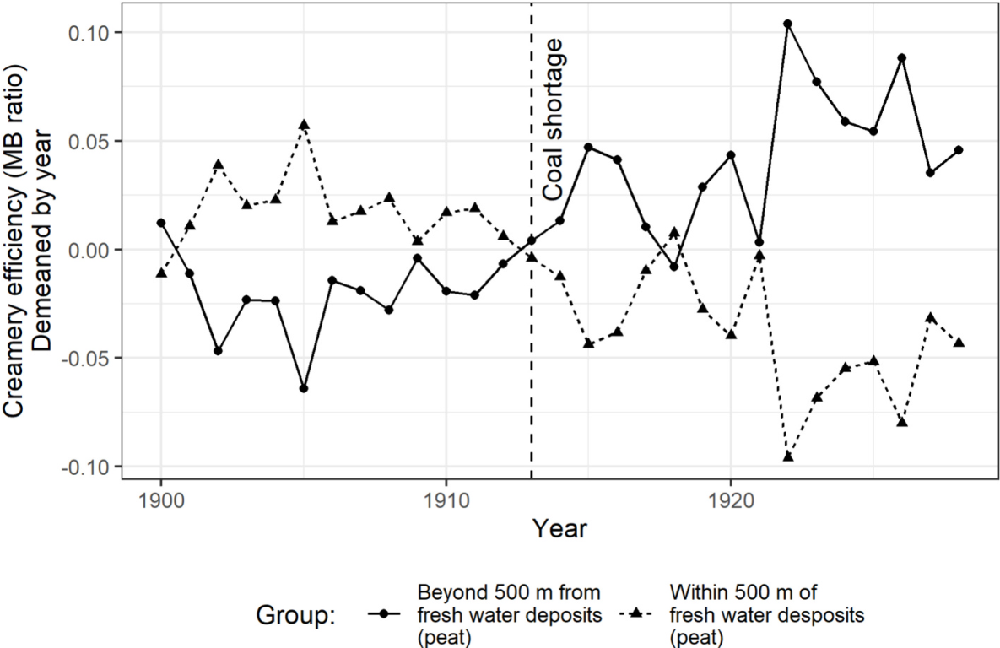
```

.small123[*Milk-to-butter ratio, demeaned by year: within vs. beyond 500 m of peat (lower = more efficient)*]
]

.pull-right[
- Event study around the coal shortage
- Creameries near peat became **more efficient**
- The advantage **persisted** after peat was no longer used
- Lesson: support adaptability for firms least able to switch energy source
]

.footnote[.small123[**Published:** *Energy Economics* (2024). [Back to other work](#ongoing)]]

---
name: ml-bias
# ML Bias in EH
### The problem: confident but wrong

.pull-left-wide[
- Many sources do not record what we need — e.g. **gender** among 3,271 Stockholm taxpayers in 1920
- Predict it from first names: a simple classifier, **81% accurate**
- The gender wage gap comes out at **−0.71** — the truth is **−0.82**
- The errors are **systematic**: naming correlates with social status
- With Torben Johansen and Julius Koschnick
]

.pull-right-narrow[
> *Here the truth is known: the tax records report gender.*
]

```{r echo=FALSE, out.width="46%", fig.align='center'}
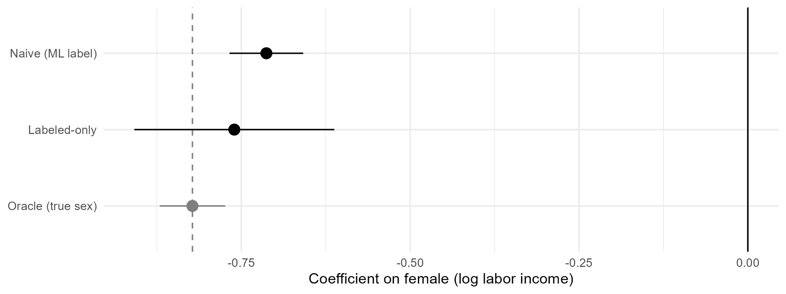
```

.footnote[.small123[**Working paper:** Johansen, Koschnick & Vedel (2026), [arXiv 2606.28063](https://arxiv.org/abs/2606.28063). [Back to other work](#ongoing)]]

---
name: ml-bias-fix
# ML Bias in EH
### The fix: a small gold standard

.pull-left-wide[
1. Predict the variable for **all** observations
2. Hand-code a small **random** subsample
3. Use it to estimate and remove the model's bias (PPI, DSL)

- Same Stockholm data, 10% gold standard: **−0.81** vs. the true **−0.82**
- Confidence interval **36% narrower** than using the hand-coded sample alone
]

.pull-right-narrow[
> *ML and the historian are complements.*
]

```{r echo=FALSE, out.width="44%", fig.align='center'}
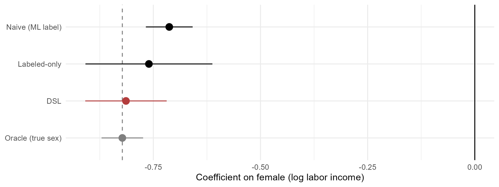
```

.footnote[.small123[**Working paper:** Johansen, Koschnick & Vedel (2026), [arXiv 2606.28063](https://arxiv.org/abs/2606.28063). [Back to other work](#ongoing)]]

---
name: ml-bias-types
# ML Bias in EH
### Three kinds of ML tasks — and what to do about each

.pull-left[
- **Type 1 — replacing annotators** (linkage, occupation coding, sentiment): always debias
- **Type 2 — filling missing data** (occupational scores, name-based proxies): debias if source and target are relevant to each other
- **Type 3 — new measures** (embeddings): no gold standard; validate against several proxies and placebos
]

.pull-right[
```{r echo=FALSE, out.width="90%"}
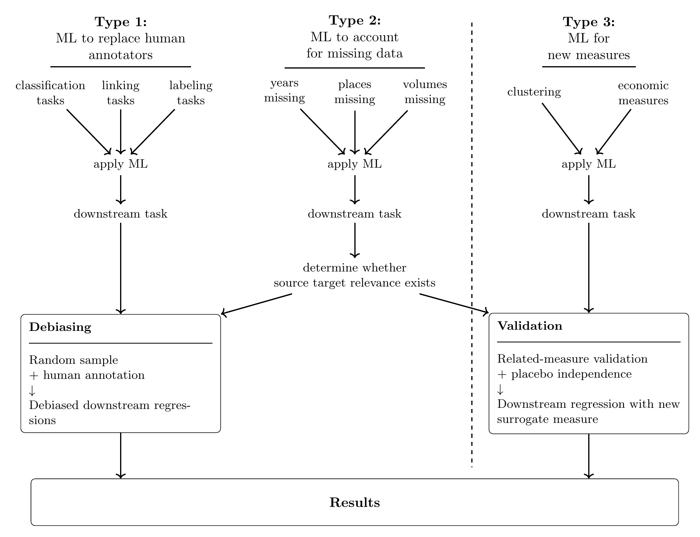
```
]

.footnote[.small123[**Working paper:** Johansen, Koschnick & Vedel (2026), [arXiv 2606.28063](https://arxiv.org/abs/2606.28063). [Back to other work](#ongoing)]]

---
name: ml-bias-scale
# ML Bias in EH
### Advice: think about the scale of your problem

.pull-left-wide[
```{r echo=FALSE, out.width="68%"}
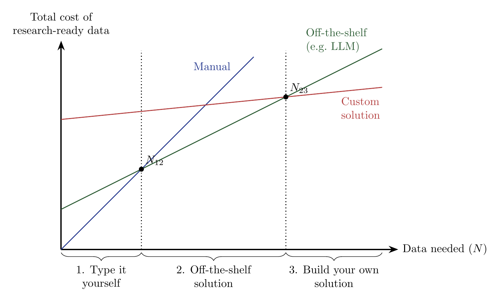
```

.small123[*Stylised total cost of research-ready data: fixed cost plus marginal cost per observation*]
]

.pull-right-narrow[
**How many hours by hand?**
- **Tens:** type it yourself
- **Hundreds to thousands:** off-the-shelf LLM / VLM
- **Thousands+:** build your own — and share it (OccCANINE)
- Validation and debiasing are never automated
]

.footnote[.small123[**Working paper:** Johansen, Koschnick & Vedel (2026), [arXiv 2606.28063](https://arxiv.org/abs/2606.28063). [Back to other work](#ongoing)]]

---
name: proj-chaos
# CHAOS
### Converting Historical Accounts into Occupational Scores

.pull-left-narrow[
- **Source:** occupations with known wages or skills — **88,000** occupation–income pairs
- **Target:** a census with occupations only
- **CHAOS** turns OccCANINE's class probabilities into a prediction for every target occupation
- With Matt Curtis, Torben Johansen and Julius Koschnick
]

.pull-right-wide[
```{r echo=FALSE, out.width="100%"}
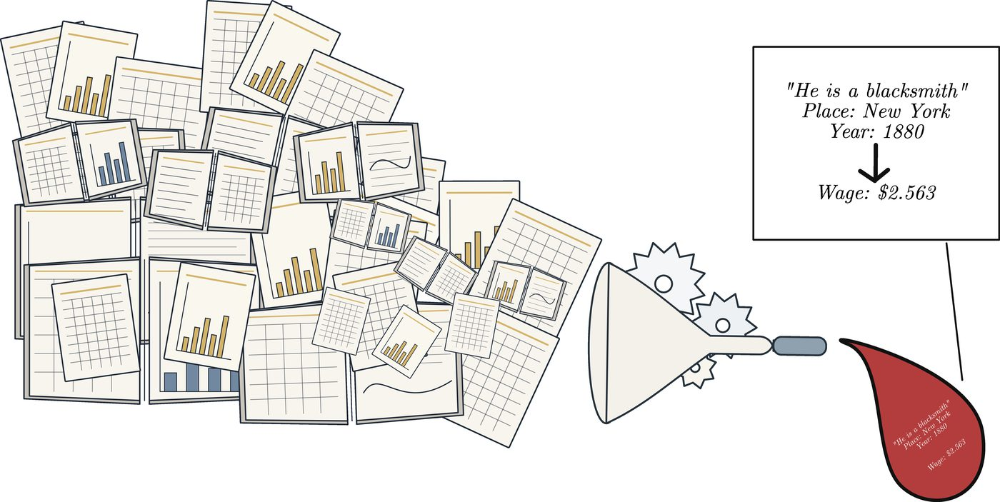
```
]

.footnote[.small123[[Back to other work](#ongoing)]]

---
name: chaos-validation
# CHAOS
### Does it work? Predicting wages out of sample

.pull-left[
```{r echo=FALSE, out.width="100%"}
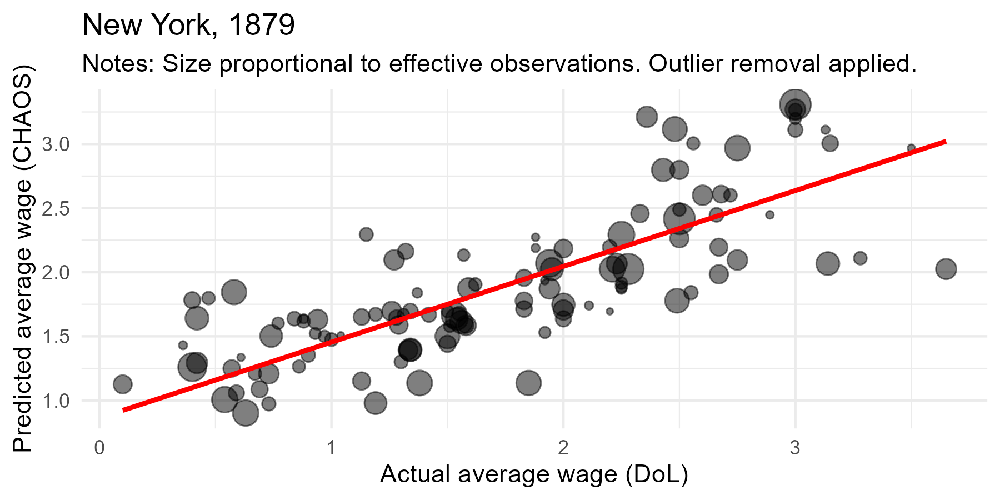
```

.small123[*Predicted vs. actual wages, New York 1879, with 1880 as the source year*]
]

.pull-right[
```{r echo=FALSE, out.width="100%"}
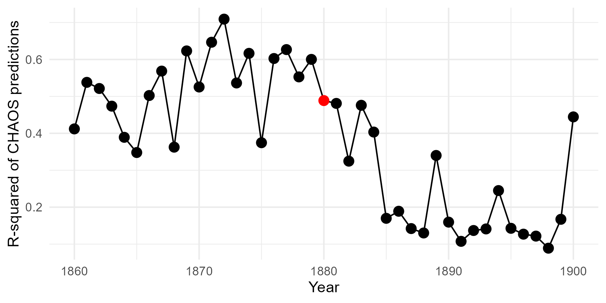
```

.small123[*R² of CHAOS predictions by year, source year in red*]
]

.footnote[.small123[Close to the source year CHAOS tracks actual wages well (R² ≈ 0.6); fit decays with distance — source–target drift, the first problem on the next slide. [Back to other work](#ongoing)]]

---
name: chaos-problem
# CHAOS
### Two problems with occupational scores

.pull-left-wide[
.small123[
$$\underbrace{\mu_S(d_i) - y_i}_{\text{proxy error}} = \underbrace{\mu_S(d_i) - \mu_T(d_i)}_{\text{source–target drift}} + \underbrace{\mu_T(d_i) - y_i}_{\text{within-occupation residual}}$$
]

- **Drift:** 1950 US wages ≠ 1850 England
- **Residual:** apprentice ≠ master; "smith" is a blacksmith or a goldsmith
- If the error correlates with the regressor, coefficients are biased
]

.pull-right-narrow[
> *CHAOS addresses the first and formalises the second — with standard errors and a full audit trail for every prediction.*
]

.footnote[.small123[[Back to other work](#ongoing)]]

---
name: chaos-skills
# CHAOS
### A first application: what happened to routine skills?

.pull-left-wide[
```{r echo=FALSE, out.width="70%"}
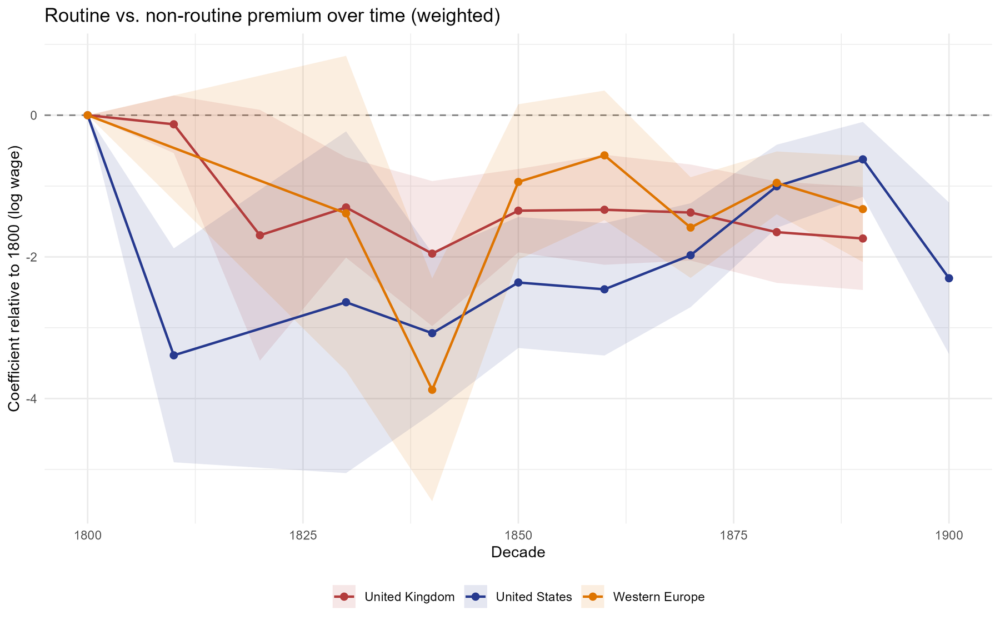
```
]

.pull-right-narrow[
- Premium for **routine** relative to non-routine work, relative to 1800
- Falls in the first half of the century in the UK, the US and Western Europe
- .chaosred[**Preliminary**]: descriptive, no controls for selection
]

.footnote[.small123[Skills: *The London Tradesman* (Campbell, 1747), descriptions of 229 occupations. Wages: US Commissioner (Department) of Labor reports — occupation–place–year cells, 1800–1900, 135,182 observations in 67 places, digitised with Gemini. [Back to other work](#ongoing)]]

---
name: chaos-embedding
# CHAOS
### Measuring skills with embeddings

.pull-left[
- An LLM extracts a list of **skills** from each occupation's 1747 description
- Each skill is embedded (Sentence-BERT) and compared with **anchor phrases**: routine vs. non-routine, cognitive vs. manual
- Gives each occupation a position in a **task space** — mapped to any census through HISCO
]

.pull-right[
```{r echo=FALSE, out.width="64%"}
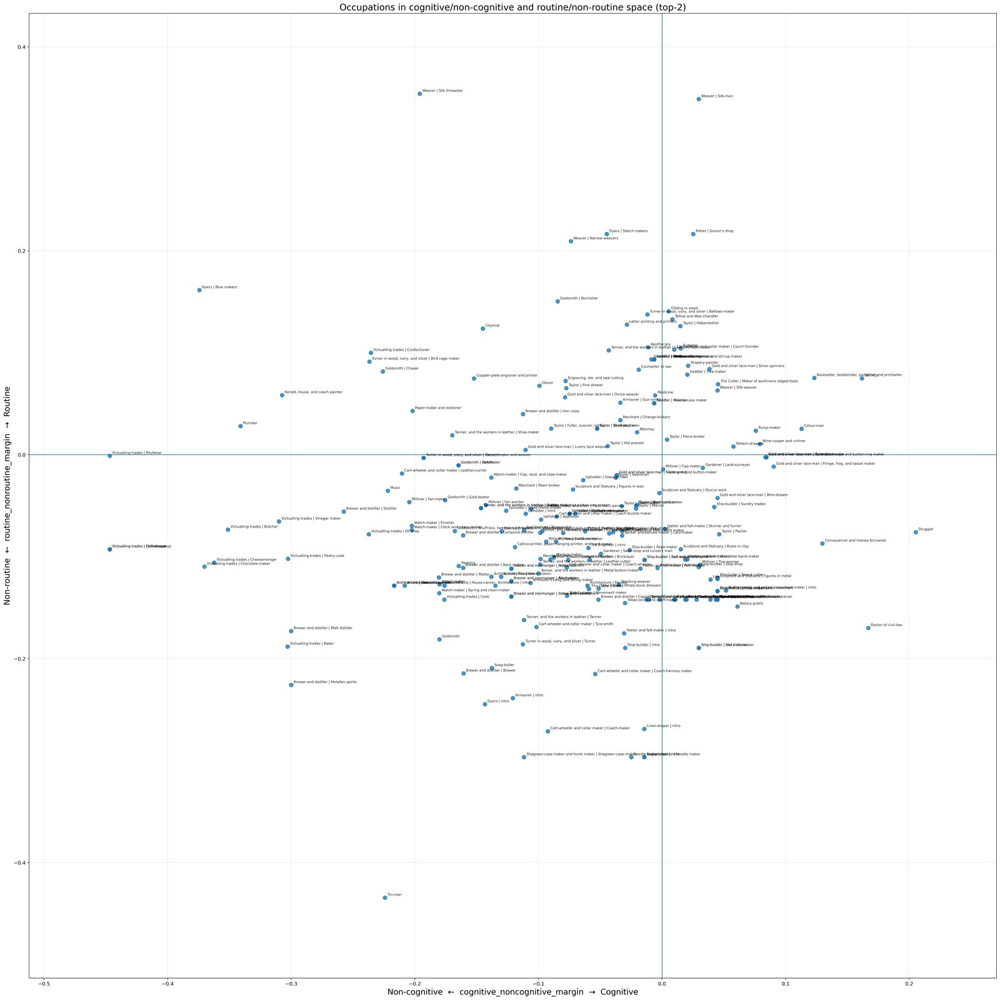
```

.small123[*Occupations in cognitive × routine space*]
]

.footnote[.small123[[Back to other work](#ongoing)]]

---
name: proj-domus
# Counting Houses
### The source: *Civitates Orbis Terrarum*

.pull-left[
- Braun & Hogenberg, Cologne, **1572–1617**
- **543 views of 475 towns**, 95% European
- A publishing enterprise, not a survey — but walls, churches and street fabric were drawn to be recognisable
- With Chiara Zanardello (TSE). .chaosred[**Preliminary**]
]

.pull-right[
```{r echo=FALSE, out.width="100%"}
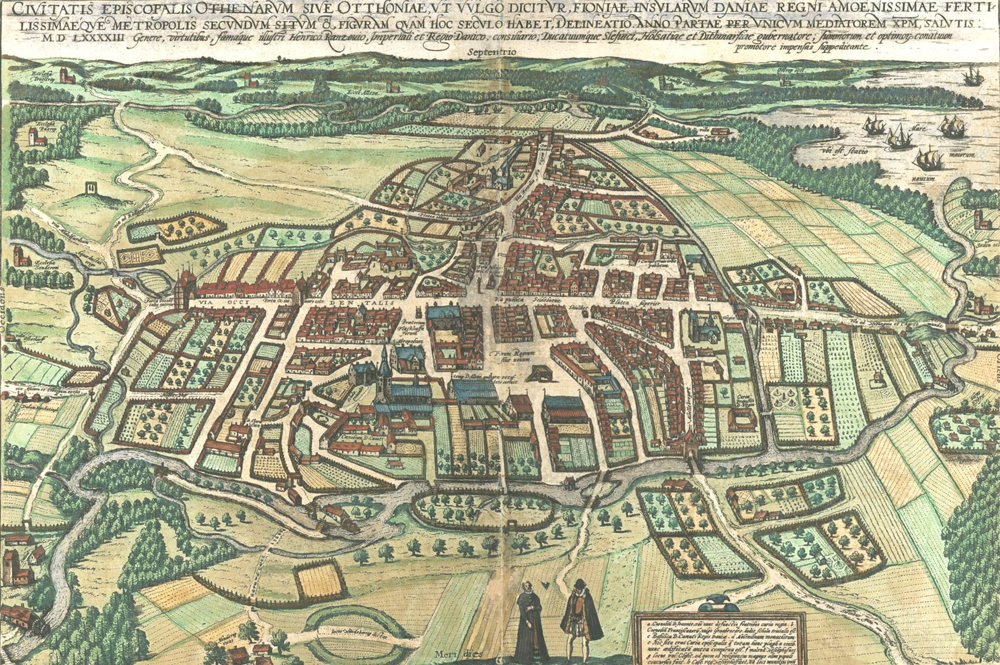
```

.small123[*Odense in the Civitates*]
]

.footnote[.small123[[Back to other work](#ongoing)]]

---
name: domus-model
# Counting Houses
### DOMUS: from a plate to a building count

```{r echo=FALSE, out.width="85%", fig.align='center'}
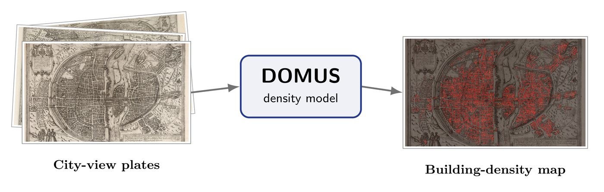
```

.pull-center-wide[
- A vision model predicts a **building density** for each plate; its integral is the count
- Trained from a few thousand clicks — one per building
]

.footnote[.small123[[Back to other work](#ongoing)]]

---
name: domus-paris
# Counting Houses
### Paris, c. 1572: every predicted building

```{r echo=FALSE, out.width="50%", fig.align='center'}
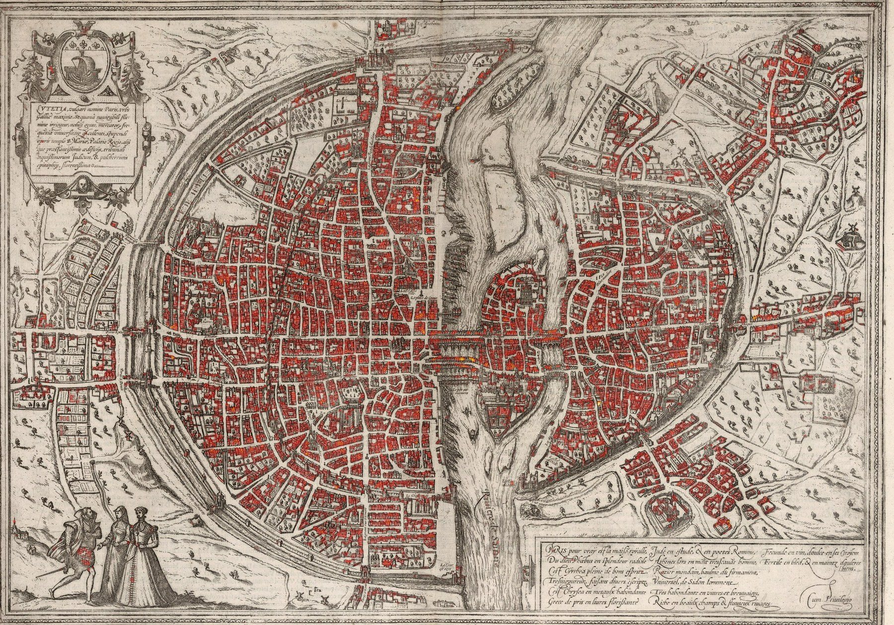
```

.footnote[.small123[Braun & Hogenberg, *Civitates Orbis Terrarum*. Red: DOMUS building density; the model counts **4,202** houses. [Back to other work](#ongoing)]]

---
name: domus-odense
# Counting Houses
### Back of the envelope: Odense, c. 1590

.pull-left[
- **883** houses on the plate
- × **4.3** people per house (Leiden, 1561–1606)
- $\approx$ **3,800** inhabitants
- Other sources: 3,000–3,200 in 1570; 4,000 in 1640
]

.pull-right[
```{r echo=FALSE, out.width="100%"}
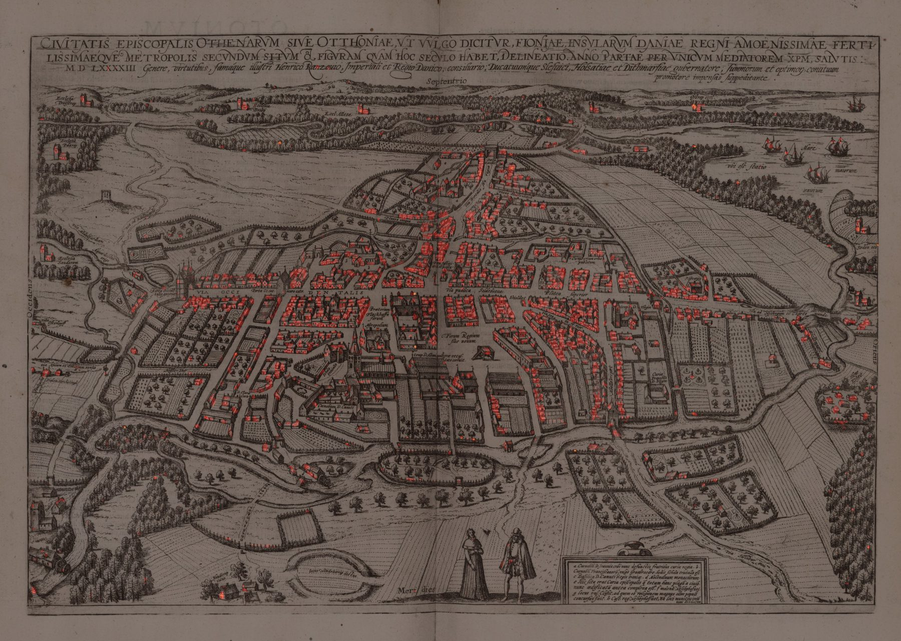
```
]

.footnote[.small123[[Back to other work](#ongoing)]]

---
name: proj-tracks
# Tracks to Modernity
### Railways, growth and social movements in Denmark

.pull-left-wide[
- **1,589 parishes**, staggered difference-in-differences for railway connection (TWFE and Callaway & Sant'Anna)
- Population **+7%**, partly through **in-migration**; no effect on fertility
- **Structural change** out of agriculture
- With Tom Görges, Magnus Ørberg Rove and Paul Sharp. R&R, *European Review of Economic History*
]

.pull-right-narrow[
```{r echo=FALSE, out.width="100%"}
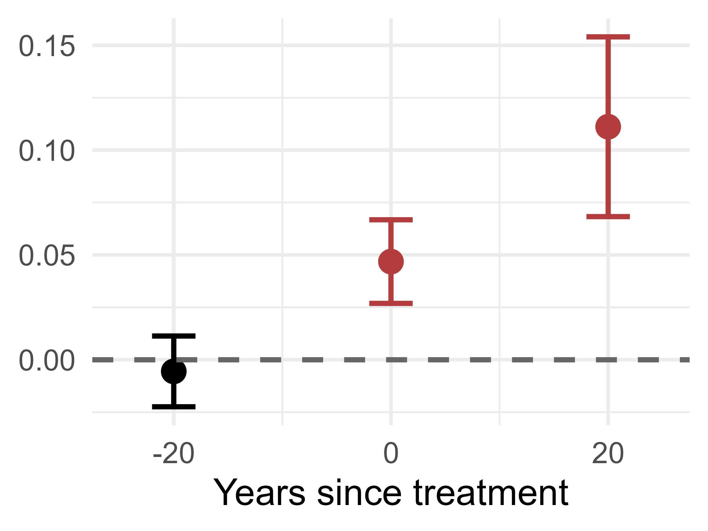
```

.small123[*Log population by years since connection*]
]

.footnote[.small123[**Working paper:** Görges, Rove, Sharp & Vedel, [arXiv 2502.21141](https://arxiv.org/abs/2502.21141) (v3, Sept 2026). [Back to other work](#ongoing)]]

---
name: tracks-economy
# Tracks to Modernity
### Migration and structural change

.small123[No pre-trends; effects appear on connection and grow with exposure (manufacturing share +1.8 pp).]

.pull-left[
```{r echo=FALSE, out.width="72%"}
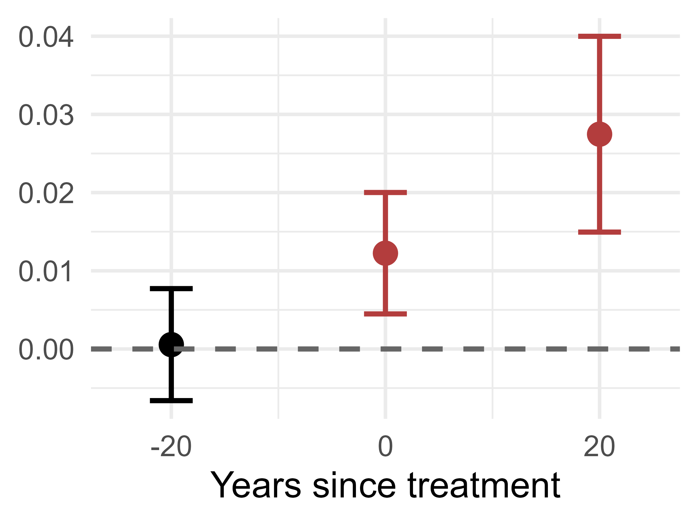
```

.small123[*Manufacturing employment share*]
]

.pull-right[
```{r echo=FALSE, out.width="72%"}
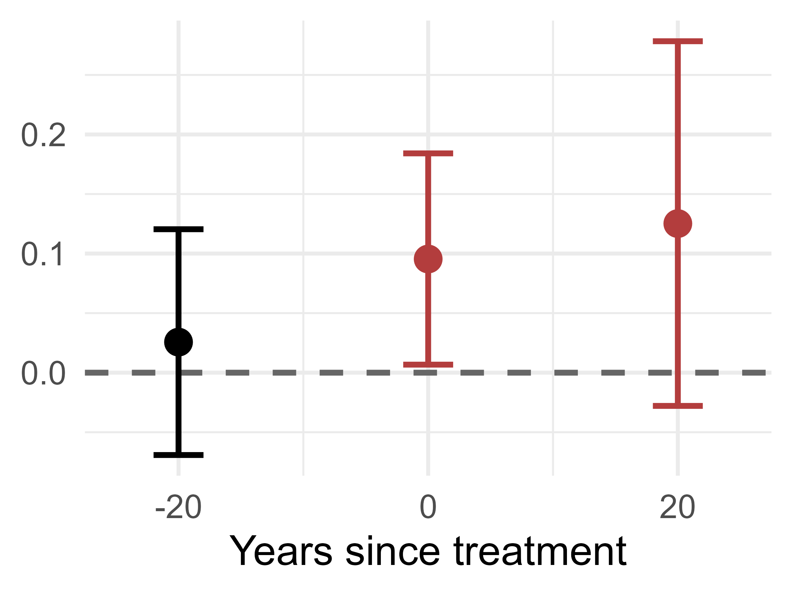
```

.small123[*Log in-migration*]
]

.footnote[.small123[**Working paper:** Görges, Rove, Sharp & Vedel, [arXiv 2502.21141](https://arxiv.org/abs/2502.21141) (v3, Sept 2026). [Back to other work](#ongoing)]]

---
name: tracks-ideas
# Tracks to Modernity
### Railways carried ideas: folk high schools and community houses

.small123[Inverse-distance densities of nearby institutions. Less robust than the economic results.]

.pull-left[
```{r echo=FALSE, out.width="72%"}

```

.small123[*Local density of folk high schools*]
]

.pull-right[
```{r echo=FALSE, out.width="72%"}

```

.small123[*Local density of community houses*]
]

.footnote[.small123[**Working paper:** Görges, Rove, Sharp & Vedel, [arXiv 2502.21141](https://arxiv.org/abs/2502.21141) (v3, Sept 2026). [Back to other work](#ongoing)]]

---
name: proj-copenhagen
# Copenhagen Tax Books
### The source

.pull-left-narrow[
- Copenhagen's income tax, enacted **1861** — 50 years before the national tax
- Annual books **1862–1918**: about **2.1 million** taxpayer records
- ~17,000 taxpayers in 1862, ~164,000 by 1919
- With Casper Worm Hansen and Asger Mose Wingender
]

.pull-right-wide[
```{r echo=FALSE, out.width="48%"}

```

.small123[*A page from the 1863–64 tax book*]
]

.footnote[.small123[[Back to other work](#ongoing)]]

---
name: cph-pipeline
# Copenhagen Tax Books
### Digitising 40 books with a vision LLM

.pull-left-wide[
1. Split each book into page images
2. Page + layout prompt + schema $\Rightarrow$ **Gemini** returns one structured row per taxpayer
3. Assemble a dataset per book
4. Occupations $\Rightarrow$ HISCO with **OccCANINE**
]

.pull-right-narrow[
> *Standard OCR fails on these tables: five layouts, shifting columns, no row delimiters.*
]

.footnote[.small123[[Back to other work](#ongoing)]]

---
name: cph-first-look
# Copenhagen Tax Books
### A first look: income inequality, 1862–1918

.pull-left-wide[
```{r echo=FALSE, out.width="62%"}

```
]

.pull-right-narrow[
- The first full income distributions for a 19th-century Danish city
- The 800 kr deduction truncates the bottom: measures are lower bounds
- .chaosred[**Preliminary**]
]

.footnote[.small123[[Back to other work](#ongoing)]]

---
name: proj-freedom
# Trade Liberalisations
### Freedom of trade and the Danish economy

.pull-left-wide[
- The **Næringsfrihed** (freedom of trade) reform (law of 1857, in force 1862) dismantled guild privileges and opened trades
- What did liberalisation do to **who worked in what, and for how much**, across places?
- DFF project *Denmark's Path to Economic Development*: **DKK 6.1M**, 2027–2030 (PI Casper Worm Hansen; named participant)
- With Casper Worm Hansen and Asger Mose Wingender. .chaosred[**Early stage**]
]

.pull-right-narrow[
```{r echo=FALSE, out.width="62%"}

```

.tiny123[Albert Gottschalk, *Marked på Stege Torv* (1892). SMK, KMS3286, public domain.]
]

.footnote[.small123[[Back to other work](#ongoing)]]

---
name: freedom-approach
# Trade Liberalisations
### Approach

.pull-left-wide[
- Parish-level occupational structure from the censuses, coded with **OccCANINE**
- Occupational incomes with **CHAOS**, linked to tax records
- Compare places and trades by how binding the old privileges were, before and after the reform
]

.pull-right-narrow[
> *The same tool chain as the rest of the programme — applied to an institutional reform.*
]

.footnote[.small123[[Back to other work](#ongoing)]]

---
name: proj-farright
# Physical Memories and the Far Right
### Did symbols of the past mobilise voters?

.pull-left-wide[
- The Danish Nazi party (**DNSAP**) built its propaganda on Denmark's pre-Christian past
- Theory: politicising the past should work best where the past is **physically present**
- Test: local density of pre-Christian monuments (burial mounds, rune stones) vs. DNSAP votes, elections **1935–1943**
- With Lasse Aaskoven
]

.footnote[.small123[**Working paper:** Aaskoven & Vedel (2026), [EHES WP 295](https://ehes.org/wp/EHES_295.pdf). [Back to other work](#ongoing)]]

---
name: farright-data
# Physical Memories and the Far Right
### Monuments and votes

.pull-left[
```{r echo=FALSE, out.width="90%"}

```

.small123[*Pre-Christian monuments*]
]

.pull-right[
```{r echo=FALSE, out.width="90%"}

```

.small123[*DNSAP vote share*]
]

.footnote[.small123[**Working paper:** Aaskoven & Vedel (2026), [EHES WP 295](https://ehes.org/wp/EHES_295.pdf). [Back to other work](#ongoing)]]

---
name: farright-result
# Physical Memories and the Far Right
### No effect

.pull-left-wide[
```{r echo=FALSE, out.width="68%"}

```
]

.pull-right-narrow[
- No relationship between monument density and the DNSAP vote
- Holds across site types (mounds, passage graves, rune stones, coins)
]

.footnote[.small123[**Working paper:** Aaskoven & Vedel (2026), [EHES WP 295](https://ehes.org/wp/EHES_295.pdf). [Back to other work](#ongoing)]]

---
name: farright-bulwark
# Physical Memories and the Far Right
### A bulwark? Civil society and party members

.pull-left[
```{r echo=FALSE, out.width="72%"}

```

.small123[*Grundtvigian institutions*]
]

.pull-right[
- Had the Grundtvigian movement already **claimed the symbols** of the pre-Christian past?
- Neither Grundtvigian nor Inner Mission institutions predict the vote
- But **18,634 geolocated party members**: more where the pietist Inner Mission was strong
- Unlike Germany, Danish civil society **neither fuelled nor blocked** the far right at the ballot box
]

.footnote[.small123[**Working paper:** Aaskoven & Vedel (2026), [EHES WP 295](https://ehes.org/wp/EHES_295.pdf). [Back to other work](#ongoing)]]

---
name: appendix
class: inverse, center, middle

# Appendix

---
name: age
# A younger population

.pull-left-wide[
```{r echo=FALSE, out.width="80%"}

```
]

.pull-right-narrow[
- Age structure in **1901**
- More young children, fewer older adults, relative to other parishes
- What growth through fertility should look like
]


[Back to fertility](#fertility)

---
name: newspapers
# Contemporaries noticed

.pull-left-wide[
```{r echo=FALSE, out.width="90%"}

```
]

.pull-right-narrow[
- Danish newspapers mentioning the Agger channel
- Attention jumps after the breach and stays high while the channel carries traffic
]


[Back to the timeline](#timeline)

---
name: robustness
# Robustness: comparison groups

.pull-left[
```{r echo=FALSE, out.width="100%"}

```

.small123[*Market access approach*]
]

.pull-right[
```{r echo=FALSE, out.width="100%"}

```

.small123[*Dummy approach*]
]

[Back to population](#pop)

---
name: robustness-param
# Robustness: market access parameters

```{r echo=FALSE, out.width="60%", fig.align='center'}

```

[Back to the strategy](#strategy)

---
name: fish-spin
# Fishing early, spinning late

.pull-left[
```{r echo=FALSE, out.width="90%"}

```

.small123[*Fishermen*]
]

.pull-right[
```{r echo=FALSE, out.width="90%"}

```

.small123[*Spinners and weavers*]
]

[Back to the occupations](#occ-detail)

.footnote[.small123[Fishing responds from the 1840s; textile work only by 1901 — a sequence from the sea, to trade, to industry.]]


---
name: trade-table
# Channel introduction and trade

.regtab[
| | (1) | (2) | (3) | (4) | (5) |
|:--|:--:|:--:|:--:|:--:|:--:|
| Dependent variable | traffic | traffic | log(traffic+1) | asinh(traffic) | 1[traffic > 0] |
| Estimator | Poisson | Poisson | OLS | OLS | OLS |
| Post × east | −0.490\*\*<br>(0.217) | −0.482\*<br>(0.249) | −0.003<br>(0.092) | −0.023<br>(0.145) | 0.012<br>(0.174) |
| Post × middle | 5.557\*\*\*<br>(0.215) | 11.76\*\*\*<br>(0.247) | 0.967\*\*\*<br>(0.058) | 1.215\*\*\*<br>(0.070) | 0.381\*\*\*<br>(0.023) |
| **Post × west** | **4.129\*\*\***<br>(0.509) | **4.698\*\*\***<br>(0.471) | 0.382<br>(0.264) | 0.506<br>(0.329) | **0.319\*\***<br>(0.126) |
| 1807–14 and 1825–33 excluded | No | Yes | No | No | No |
| Observations | 13,356 | 11,214 | 13,356 | 13,356 | 13,356 |
]

[Back to the Sound Toll results](#trade)

.footnote[.small123[Port-level panel from the Sound Toll registers. Standard errors clustered by port. ∗∗∗ p<0.01, ∗∗ p<0.05, ∗ p<0.1. Paper, Table "Channel Introduction and Trade".]]

???
- West and middle Limfjord ports trade far more after the opening; no comparable rise for the east (Aalborg), which if anything loses.
- Column (2) drops the Napoleonic war years and the years between the breach and navigability.
- The log and asinh columns are imprecise for the west; the extensive margin (5) shows west ports start trading at all.

---
name: channel-traffic
# Ships through the new channel

.pull-left-wide[
```{r echo=FALSE, out.width="100%"}

```
]

.pull-right-narrow[
- Ships passing the channel itself: **19** in 1835 $\Rightarrow$ nearly **2,000** in 1855
- Agger silts up in the 1860s; **Thyborøn**, opened by another storm in 1862, takes over
]

[Back to the Sound Toll results](#trade)

---
name: balance
# Balance

```{r echo=FALSE, out.width="70%", fig.align='center'}

```

[Back to the strategy](#strategy)

---
name: fertility-ma
# Fertility and migration: market access versions

.pull-left[
```{r echo=FALSE, out.width="80%"}

```

.small123[*Child–woman ratio*]
]

.pull-right[
```{r echo=FALSE, out.width="80%"}

```

.small123[*Born in another county*]
]

[Back to fertility](#fertility)

---
name: adaptation
# Adaptation after the opening

.pull-left[
- **1840s:** new ports in all west Limfjord market towns
- **1841:** independent trading rights
- **1852:** first Danish steam route to England
- **1856–61:** Frederik VII canal at Løgstør
]

.pull-right[
```{r echo=FALSE, out.width="80%"}

```

.small123[*Placat announcing trading rights for Limfjord market towns, 1841*]
]

[Back to the timeline](#timeline)

---
name: fish
# The fish windfall

```{r echo=FALSE, out.width="60%", fig.align='center'}

```
.center[.small123[*Herring catch in the Limfjord (Poulsen et al., 2007)*]]

[Back to the timeline](#timeline)

---
name: arch-estimator
# From dating ranges to a panel

.pull-left[
- Have: $P(t \mid c)$ for each find $c$ (a dating range)
- Want: $P(\{c\} \mid t)$, the probability of *any* find at site $i$ in year $t$
- Sample $t$ for each find, count, repeat
]

.pull-right[
.small123[
$$P(\{c\}\mid t)=\left[1-\prod_{c=1}^{K_i}\left(1-P(t\mid c)\right)\right]P(\{c\})$$
]
- $P(t \mid c)$ uniform over the range, or normal with $\sigma_c = (Year^{c}_{max}-Year^{c}_{min})/1.96$
]

[Back to the method](#arch-source)

---
name: arch-matching
# Matching on soil type

.pull-left[
```{r echo=FALSE, out.width="80%"}

```

.small123[*Before matching*]
]

.pull-right[
```{r echo=FALSE, out.width="80%"}

```

.small123[*After matching*]
]

[Back to the method](#arch-source)

---
name: arch-ma
# Mirror experiment: market access approach

.pull-left[
```{r echo=FALSE, out.width="100%"}

```

.small123[*Coin finds*]
]

.pull-right[
```{r echo=FALSE, out.width="100%"}

```

.small123[*Building finds*]
]

[Back to the results](#arch)

